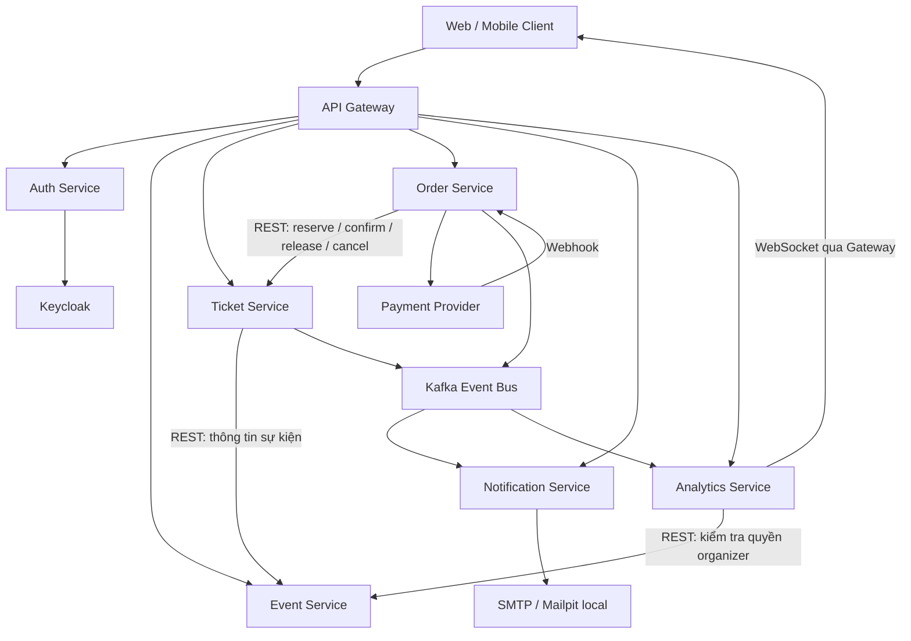

# EventHub — Hệ thống Quản lý và Đặt vé Sự kiện theo kiến trúc Microservices

EventHub hỗ trợ quy trình tổ chức và bán vé sự kiện: ban tổ chức tạo sự kiện, quản trị viên duyệt nội dung, khách hàng chọn hạng vé và thanh toán, hệ thống phát hành vé QR, gửi thông báo và tổng hợp số liệu doanh thu, điểm danh.

Dự án tách thành **6 service nghiệp vụ** và **API Gateway**, với database riêng cho từng service. Các thao tác cần phản hồi ngay sử dụng REST; thông báo và cập nhật báo cáo sử dụng Kafka.

## Business Process

- **Domain**: Quản lý sự kiện, đặt vé và kiểm soát vé điện tử.
- **Actors**: Khách hàng (`CUSTOMER`), Ban tổ chức (`ORGANIZER`), Quản trị viên (`ADMIN`), cổng thanh toán và thiết bị quét QR.
- **Quy trình trọng tâm**:
  1. Ban tổ chức tạo sự kiện, cấu hình hạng vé **VIP / PREMIUM / STANDARD** và gửi duyệt.
  2. Quản trị viên duyệt hoặc từ chối. Sự kiện được duyệt có thể công bố để khách hàng tìm kiếm và đặt vé.
  3. Khách hàng chọn vé, nhập thông tin người sử dụng. Ticket Service giữ chỗ trong **3 phút**, Order Service ghi nhận đơn và giá tại thời điểm đặt.
  4. Khách hàng thanh toán. Sau khi xác minh webhook, Order Service gọi Ticket Service xác nhận reservation và phát hành vé QR.
  5. Notification Service nhận sự kiện Kafka để gửi email vé và thông báo in-app; Analytics Service cập nhật báo cáo.
  6. Tại cổng, vé được kiểm tra và chuyển trạng thái check-in/check-out; số người tham dự được cập nhật cho dashboard.
  7. Khách hàng có thể yêu cầu hoàn tiền khi đáp ứng điều kiện. Sau khi được duyệt và provider xác nhận hoàn tiền, hệ thống điều phối hủy vé, gửi thông báo và cập nhật số liệu.

Máy trạng thái sự kiện: `DRAFT → SUBMITTED → APPROVED → PUBLISHED → CLOSED`; sự kiện bị từ chối có thể chỉnh sửa và gửi duyệt lại. `CLOSED` có nghĩa ngừng bán vé.

Tài liệu nghiệp vụ: [Danh mục service](services.md), [Kiến trúc và luồng dữ liệu](docs/architecture/README.md), [Đối chiếu báo cáo BC_32_V2](docs/architecture/source-decisions.md).

## Architecture

Sơ đồ dưới mô tả kiến trúc mục tiêu:



| **Component** | **Responsibility** | **Tech Stack / Integration** | **Port local** |
|---|---|---|---|
| **Frontend** | Giao diện khách hàng, ban tổ chức và quản trị | ReactJS theo định hướng; chưa triển khai | — |
| **API Gateway** | Điểm vào REST, xác thực và chuyển tiếp WebSocket | Spring Boot; module nền, chưa có routing/security | 8080 |
| **Auth Service** | API tài khoản riêng, điều phối identity với Keycloak | Spring Boot + JPA + MySQL; tích hợp Keycloak đang chuẩn bị | 8081 |
| **Event Service** | Danh mục, thông tin và vòng đời sự kiện | Spring Boot + JPA + MySQL | 8082 |
| **Ticket Service** | Hạng vé, tồn kho, reservation, phát hành và quét QR | Spring Boot + JPA + MySQL; Kafka theo thiết kế | 8083 |
| **Order Service** | Đơn hàng, người nhận vé, thanh toán, webhook và hoàn tiền | Spring Boot + JPA + MySQL; Payment Provider/Kafka theo thiết kế | 8084 |
| **Notification Service** | Template, email và thông báo in-app | Spring Boot + JPA + MySQL + Flyway + Spring Kafka + Spring Mail | 8085 |
| **Analytics Service** | Projection doanh số, điểm danh và dashboard | Spring Boot + JPA + MySQL + Flyway + Spring Kafka; WebSocket theo thiết kế | 8086 |

### Infrastructure

| **Component** | **Responsibility** | **Address local** |
|---|---|---|
| **MySQL 8.4** | Database riêng cho các module | `localhost:33101`–`localhost:33107` |
| **Kafka 3.8.1 — KRaft** | Event bus, không cần Zookeeper | `localhost:29092` |
| **Kafka UI** | Xem topic và message khi phát triển | [localhost:8089](http://localhost:8089) |
| **Mailpit SMTP** | Nhận email thử nghiệm ở môi trường local | `localhost:1025` |
| **Mailpit Web** | Xem email đã gửi vào Mailpit | [localhost:8025](http://localhost:8025) |

**Trạng thái hiện tại:** đã có các module backend, entity, cấu hình Compose, hợp đồng OpenAPI/Kafka và migration nền của Notification/Analytics. Các lớp nghiệp vụ, API, Gateway routing, consumer/producer và frontend đang được phát triển. Compose chưa bao gồm Keycloak/Redis; cổng thanh toán chưa được chọn. Khởi động container chưa đồng nghĩa luồng đặt vé đã chạy hoàn chỉnh.

Gateway hiện còn datasource/database từ scaffold; chưa có yêu cầu database nghiệp vụ riêng cho Gateway. Trong mạng Docker, mọi backend nghe cổng **8080**; các cổng trong bảng là cổng truy cập từ máy host.

Tài liệu chi tiết: [Kiến trúc](docs/architecture/README.md), [Database và ERD](docs/database/README.md), [Hướng dẫn Docker](Docker.md).

## Getting Started

### Prerequisites

- Git.
- Docker Engine hoặc Docker Desktop, kèm Docker Compose v2.
- **JDK 21 trở lên** nếu build/chạy ngoài Docker. Mã nguồn đặt Java release 21; Dockerfile hiện dùng JDK 23 để build và JRE 21 để chạy.
- Maven Wrapper có sẵn trong repository; lần build đầu cần mạng để tải dependency.

### 1. Clone repository

```bash
git clone https://github.com/duymk123/EventHub.git
cd EventHub
```

### 2. Configure environment

Tạo file `.env` tại thư mục gốc với biến bắt buộc của Compose:

```dotenv
MYSQL_ROOT_PASSWORD=your_local_mysql_password
```

Thay giá trị mẫu bằng mật khẩu local. Giữ `.env` ở máy cá nhân, không commit lên Git. Mailpit local không yêu cầu tài khoản SMTP. Cấu hình Keycloak, issuer/audience, role mapping và xác thực service-to-service sẽ được bổ sung khi tích hợp.

### 3. Start the development stack

```bash
docker compose up --build -d
```

Compose khởi tạo các MySQL instance, Kafka, topic, Kafka UI, Mailpit và bảy module backend. Notification/Analytics chạy Flyway trước bước Hibernate kiểm tra schema.

Kiểm tra trạng thái và log khởi tạo:

```bash
docker compose ps
docker compose logs kafka-init
docker compose logs --tail=100 notification-service analytics-service
```

Chi tiết cấu hình và xử lý schema đã có dữ liệu: [Docker.md](Docker.md).

### 4. Build backend locally

Để chạy service bằng IntelliJ, dùng MySQL trên máy và chỉ chạy Kafka/Redis bằng Docker, xem [hướng dẫn phát triển local](docs/local-development.md).

PowerShell, chạy tại root repository:

```powershell
.\mvnw.cmd clean package
```

Linux/macOS:

```bash
chmod +x mvnw
./mvnw clean package
```

Nếu Maven Wrapper trên Windows lỗi khi tìm Maven cache, có thể dùng Maven 3.9.x đã cài với lệnh `mvn clean package`.

Để chạy một module ngoài Docker, cấu hình kết nối MySQL qua `DB_HOST`, `DB_PORT`, `DB_NAME`, `DB_USERNAME`, `DB_PASSWORD`. Ví dụ Notification Service trong PowerShell, sau khi database và Kafka đã sẵn sàng:

```powershell
$env:DB_HOST = 'localhost'
$env:DB_PORT = '33105'
$env:DB_NAME = 'eventhub_notification'
$env:DB_USERNAME = 'root'
$env:DB_PASSWORD = '<mat-khau-local-trong-.env>'
$env:SPRING_KAFKA_BOOTSTRAP_SERVERS = 'localhost:29092'
$env:MAIL_HOST = 'localhost'
$env:MAIL_PORT = '1025'
.\mvnw.cmd -pl notification-service spring-boot:run
```

Chọn chạy module bằng Docker hoặc IDE/Maven trên cùng cổng để tránh trùng port. Dự án hiện không giữ file/dependency test theo yêu cầu của nhóm; kiểm chứng thay đổi bằng build và chạy thử phù hợp.

### Kafka and development email

Có thể khởi động riêng hạ tầng Kafka/email:

```bash
docker compose up -d kafka kafka-init kafka-ui mailpit
docker compose exec kafka /opt/kafka/bin/kafka-topics.sh --bootstrap-server kafka:9092 --describe
```

`kafka-init` tạo bảy topic nghiệp vụ và hai DLQ, mỗi topic ba partition, replication factor một trong môi trường local:

| **Topic** | **Producer** | **Consumer theo thiết kế** |
|---|---|---|
| `order.paid` | Order | Analytics |
| `order.failed` | Order | Notification |
| `order.refunded` | Order | Notification, Analytics |
| `ticket.issued` | Ticket | Notification |
| `ticket.checked-in`, `ticket.checked-out` | Ticket | Analytics |
| `ticket.cancelled` | Ticket | Chưa đăng ký consumer giai đoạn hiện tại |
| `notification.dlq`, `analytics.dlq` | Consumer tương ứng | Phục vụ kiểm tra và replay khi vận hành |

Trong Docker, Kafka dùng `kafka:9092`; trên máy host dùng `localhost:29092`. Mailpit lưu email thử nghiệm để xem tại [localhost:8025](http://localhost:8025). Chi tiết payload, key, retry và idempotency: [Kafka events](docs/kafka/events.md).

## API Documentation

Các file OpenAPI 3.0.3 mô tả **hợp đồng mục tiêu**, hiện ở trạng thái draft. Danh sách endpoint trong tài liệu không đồng nghĩa đã có controller xử lý.

- [Auth Service API](docs/api/auth-service-openapi.yaml)
- [Event Service API](docs/api/event-service-openapi.yaml)
- [Ticket Service API](docs/api/ticket-service-openapi.yaml)
- [Order Service API](docs/api/order-service-openapi.yaml)
- [Notification Service API](docs/api/notification-service-openapi.yaml)
- [Analytics Service API](docs/api/analytics-service-openapi.yaml)

Quy ước: REST public `/api/v1/**`, API nội bộ `/internal/**`, WebSocket dashboard dự kiến `/ws/dashboard` với route riêng tại Gateway. API nội bộ yêu cầu xác thực giữa các service và không công khai qua Gateway.

## Project Structure

```text
EventHub/
├── api-gateway/
├── auth-service/
├── event-service/
├── ticket-service/
├── order-service/
├── notification-service/
├── analytics-service/
├── front-end/
├── docs/
│   ├── api/
│   ├── architecture/
│   ├── database/
│   ├── kafka/
│   └── plans/
├── infrastructure/
├── docker-compose.yml
└── pom.xml
```

Trong từng service, `entity` chỉ chứa entity/mapped superclass; enum nằm ở `common`. Controller gọi service interface, logic nằm trong service implementation, repository chỉ truy cập database của chính service.

## Development Guidelines

- **ID**: UUID cho mọi PK và ID tham chiếu của ứng dụng; Java `UUID`, MySQL `CHAR(36)`, API UUID string dài 36 ký tự.
- **Ticket types**: chỉ `VIP`, `PREMIUM`, `STANDARD`; tồn kho gộp trong `ticket_types` do Ticket Service sở hữu.
- **Database per Service**: không JOIN, truy cập SQL hoặc tạo FK vật lý xuyên service.
- **Kafka**: `messageId` là UUID message, `eventId` là UUID sự kiện; retry/replay giữ nguyên messageId.
- **Money and time**: BigDecimal cho tiền, UTC cho thời điểm nghiệp vụ; chỉ số báo cáo và chính sách hoàn tiền theo quyết định đã chốt.
- **Schema**: Notification/Analytics dùng Flyway và `ddl-auto: validate`; thay đổi bảng đã triển khai đi qua migration mới.

| **Document** | **Content** |
|---|---|
| [Kế hoạch sáu service](docs/plans/README.md) | Hàm service/repository, DTO, transaction và trình tự triển khai |
| [Quy ước kiến trúc/code](SKILL.md) | Phân lớp, dữ liệu, bảo mật và messaging |
| [Code templates](code-templates.md) | Entity/UUID, BaseEntity tùy schema, mapper, controller, producer/consumer |
| [Database và ERD](docs/database/README.md) | Schema tham chiếu, UUID và sơ đồ từng service |
| [Các điểm cần chốt](docs/project-clarifications.md) | Email/chủ vé, địa điểm, refund, provider, cổng và chỉ số dashboard |
| [Workflow](WORKFLOW.md) | Quy trình sửa, kiểm tra và chia sẻ thay đổi |
| [Hướng dẫn Git](huong-dan-push-code.md) | Các thao tác Git/PR của dự án |
| [Dữ liệu mẫu](infrastructure/mysql/seed/README.md) | Chuẩn bị và nạp seed sau migration |

## Useful Commands

```bash
# Xem trạng thái container
docker compose ps

# Theo dõi log một service
docker compose logs -f notification-service

# Theo dõi các thành phần Kafka
docker compose logs -f kafka kafka-init

# Vào shell của container
docker compose exec order-service sh

# Dừng stack, giữ lại volume dữ liệu
docker compose down

# Kiểm tra ERD đồng bộ với DDL, nếu đã cài Node.js
node docs/database/render-erd.mjs --check
```
