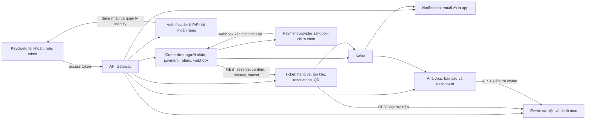
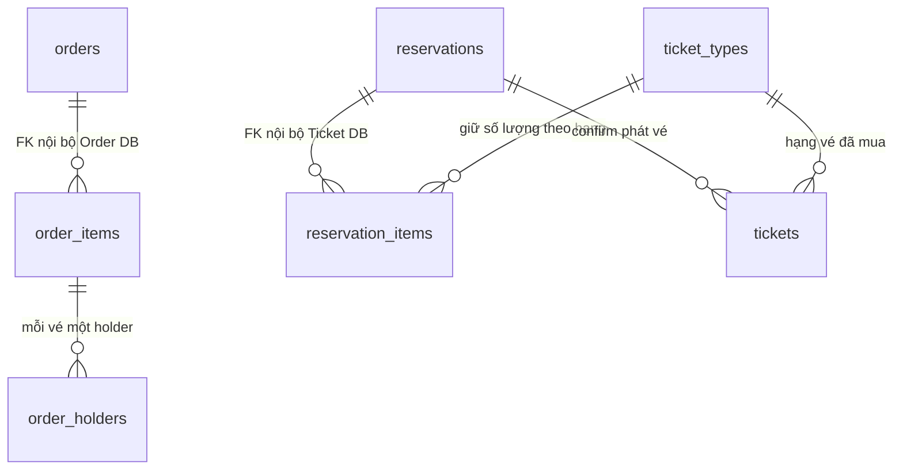

# Kiến trúc và luồng dữ liệu EventHub

Đọc [quyết định đã đối chiếu BC_32_V2](source-decisions.md) trước. Đây là thiết kế mục tiêu; repo chưa có code nghiệp vụ. Những nhánh chưa đủ yêu cầu nằm ở [C01–C09](../project-clarifications.md).

## Ai giữ dữ liệu nào?

Mỗi khối nghiệp vụ có DB riêng. Đường REST/Kafka không có nghĩa được đọc SQL của nhau. Đã chốt Auth Service làm facade cho UI/API tài khoản riêng, gọi Keycloak; không tự tạo hệ thống mật khẩu/token thứ hai. DB profile chỉ thêm nếu cần.

## Ví dụ một đơn mua ba vé

Một order có hai order_items: VIP số lượng 2 và STANDARD số lượng 1. Mỗi item có các order_holders tương ứng: hai người cho VIP, một người cho STANDARD. Ticket giữ một reservation với hai reservation_items, rồi phát hành ba tickets khi confirm thành công.

orders.reservation_id và reservations.order_id chỉ là UUID mềm giữa hai DB, không tạo FK trong sơ đồ trên. ticket_types.event_id cũng là UUID mềm sang Event. Schema chi tiết ở [database README](../database/README.md).

## Khi trả tiền thành công

1. Order sinh UUID, yêu cầu Ticket giữ chỗ ba phút. Ticket trả reservationId, hạn và giá đã chốt.
2. Order lưu orders/items/holders. Nếu lưu lỗi sau reserve thì release bù trừ.
3. Provider báo thành công qua webhook đã xác minh. Order thắng CAS mới chuyển PAID; scheduler không được chuyển PAID sang EXPIRED.
4. Order gọi REST confirm. Ticket tạo vé/QR trong transaction rồi đưa ticket.issued vào outbox.
5. Sau confirm thành công, Order ghi order.paid để Analytics tính doanh số. Notification nhận ticket.issued để gửi vé. Không phát vé thêm bằng consumer order.paid.

Lỗi tạm thời cần job retry bền vững. Nếu reservation đã hết hạn dù tiền đã thu, hoặc provider đã hoàn tiền nhưng Ticket không thể hủy, đó là nhánh còn cần quy tắc C05/C06; không chỉ retry vô hạn.

## Báo cáo không phải database gốc

Analytics nhận message để dựng bản đọc phục vụ báo cáo, không JOIN Order/Ticket DB. Doanh số chỉ cộng từ order.paid và tiền hoàn chỉ từ order.refunded. Attendance nhận hai topic có thể đảo thứ tự; phải tổng hợp trạng thái từng vé. Dashboard qua `/ws/dashboard`, Gateway có route WS riêng; REST vẫn qua `/api/v1/**`.
