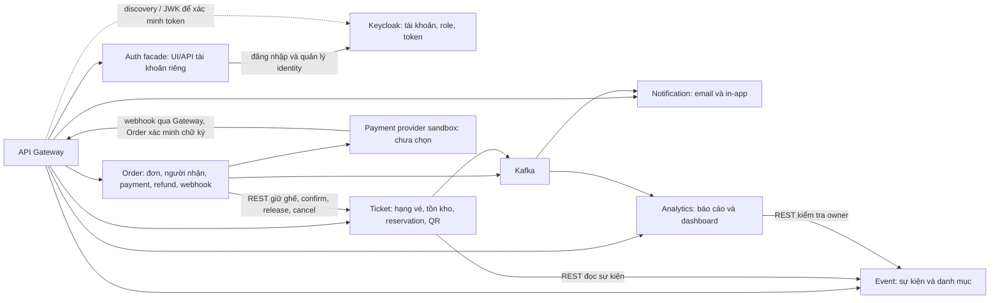
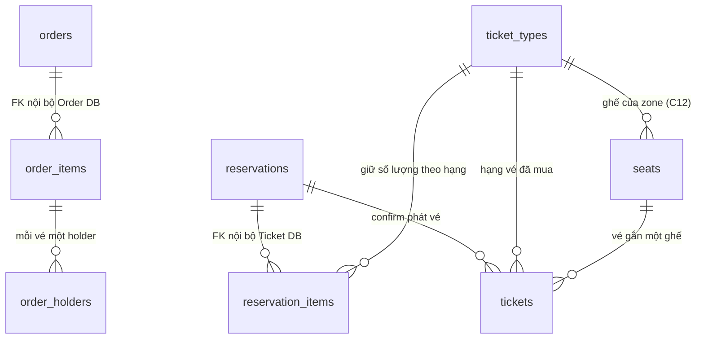

# Kiến trúc và luồng dữ liệu EventHub

Đọc [quyết định đã đối chiếu BC_32_V2](source-decisions.md) trước. Đây là thiết kế mục tiêu; repo chưa có code nghiệp vụ. Những nhánh chưa đủ yêu cầu nằm ở [C01–C09](../project-clarifications.md).

API Gateway có [tài liệu nhập môn và luồng request](api-gateway.md) cùng [plan triển khai riêng](../plans/api-gateway.md): routing, JWT/CORS, REST nội bộ, webhook và WebSocket.

## Ai giữ dữ liệu nào?

Mỗi khối nghiệp vụ có DB riêng. Đường REST/Kafka không có nghĩa được đọc SQL của nhau. Đã chốt Auth Service làm facade cho UI/API tài khoản riêng, gọi Keycloak; không tự tạo hệ thống mật khẩu/token thứ hai. DB profile chỉ thêm nếu cần.

## Ví dụ một đơn mua ba vé

Một order có hai order_items: VIP số lượng 2 và STANDARD số lượng 1. Mỗi item có các order_holders tương ứng: hai người cho VIP, một người cho STANDARD. Theo C12, mỗi holder gắn một ghế cụ thể (ví dụ VIP B-07, B-08 và STANDARD D-12). Ticket giữ một reservation với hai reservation_items và ba ghế, rồi phát hành ba tickets, mỗi vé một ghế, khi confirm thành công.

orders.reservation_id và reservations.order_id chỉ là UUID mềm giữa hai DB, không tạo FK trong sơ đồ trên. ticket_types.event_id cũng là UUID mềm sang Event. Schema chi tiết ở [database README](../database/README.md).

## Khi trả tiền thành công

1. Khách chọn zone trên sơ đồ 3D rồi chọn từng ghế (C12). Order sinh UUID, gửi danh sách ghế sang Ticket để giữ mười phút (C16). Ticket giữ bằng UPDATE có điều kiện trên từng ghế, trả reservationId, hạn và giá đã chốt; ghế đã bị lấy thì trả 409 SEAT_TAKEN để khách chọn lại.
2. Order lưu orders/items/holders (mỗi holder gắn một ghế). Nếu lưu lỗi sau khi giữ ghế thì release bù trừ. Chi tiết [C12](../project-clarifications.md#c12--đặt-vé-theo-ghế-cụ-thể).
3. Provider báo thành công qua webhook đã xác minh. Order thắng CAS mới chuyển PAID; scheduler không được chuyển PAID sang EXPIRED.
4. Order gọi REST confirm. Ticket tạo vé/QR trong transaction rồi đưa ticket.issued vào outbox.
5. Sau confirm thành công, Order ghi order.paid để Analytics tính doanh số. Notification nhận ticket.issued để gửi vé. Không phát vé thêm bằng consumer order.paid.

Thanh toán qua VNPay sandbox (C06): khách trả tiền trên trang VNPay, IPN của VNPay là kết quả chính thức, `querydr` dùng để đối soát khi chưa nhận IPN. Hoàn tiền theo C05 rút gọn: ADMIN duyệt → Ticket hủy vé, trả ghế → VNPay hoàn 70% → `order.refunded`; lỗi thì refund FAILED để ADMIN thử lại. Task retry bền vững, verify khi kết quả chưa rõ, hold trước provider và hoàn bù 100% là hướng phát triển ([thiết kế đầy đủ](payment-refund-recovery.md)).

## Báo cáo không phải database gốc

Analytics nhận message để dựng bản đọc phục vụ báo cáo, không JOIN Order/Ticket DB. Doanh số chỉ cộng từ order.paid và tiền hoàn chỉ từ order.refunded. Attendance nhận hai topic có thể đảo thứ tự; phải tổng hợp trạng thái từng vé. Dashboard qua `/ws/dashboard`, Gateway có route WS riêng; REST vẫn qua `/api/v1/**`.
