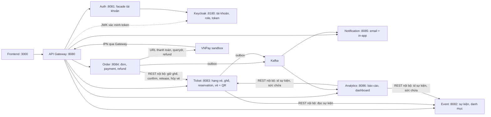
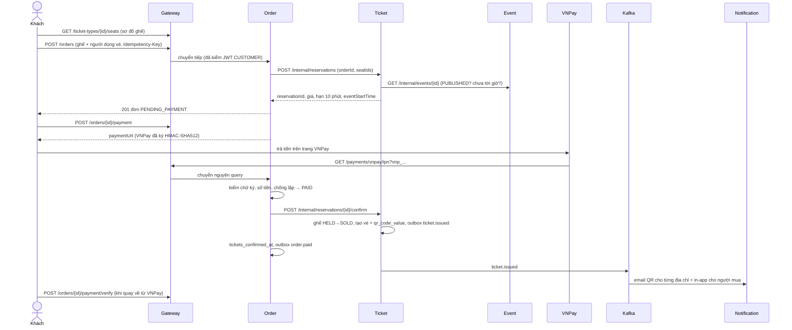
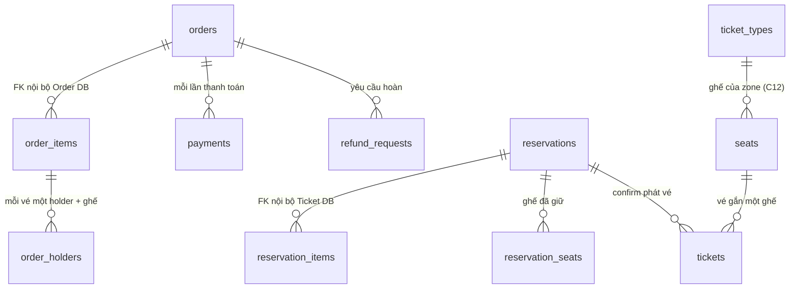

# Kiến trúc và luồng dữ liệu EventHub

Cập nhật 2026-11-24 theo code đã merge (Auth, Event, Ticket, Order, Notification, Analytics) và API Gateway (PR #33). Quyết định nghiệp vụ ở [C02–C23](../project-clarifications.md), đối chiếu báo cáo BC_32_V2 ở [source-decisions](source-decisions.md). Hợp đồng API từng service ở [docs/api](../api/README.md), message Kafka ở [docs/kafka/events.md](../kafka/events.md).

## 1. Ai giữ dữ liệu nào?



- Mỗi service có DB riêng (`eventhub_<service>`); không service nào đọc SQL của service khác. Tham chiếu chéo (orderId, reservationId, eventId…) là UUID mềm, không có FK.
- Frontend chỉ gọi Gateway. Gateway kiểm JWT và quyền theo method + path, chặn `/internal/**`, rồi chuyển tiếp ([plan Gateway §10](../plans/api-gateway.md)). Service vẫn tự kiểm quyền và owner.
- Gọi nội bộ giữa service dùng token `client_credentials` của Keycloak (service account), đi thẳng tới service, không qua Gateway.
- Order và Ticket ghi message vào bảng `outbox_events` cùng transaction nghiệp vụ; publisher gửi Kafka sau commit (không mất message khi Kafka tạm lỗi).

## 2. Mua vé và thanh toán (luồng chính)



1. **Giữ ghế** ([C12](../project-clarifications.md#c12--đặt-vé-theo-ghế-cụ-thể), C16, C17): `ReservationServiceImpl.reserve` chạy một câu `UPDATE seats … WHERE status='AVAILABLE'` cho đúng các ghế; thiếu dòng nào thì rollback và trả 409 `SEAT_TAKEN` kèm `takenSeatIds`. Không khóa cả hạng vé nên nhiều người mua cùng lúc chỉ tranh nhau khi chọn trùng ghế. Sự kiện chưa PUBLISHED hoặc đã tới giờ bắt đầu → 409 `TICKET_TYPE_NOT_ON_SALE`.
2. **Tạo đơn** (`OrderServiceImpl.create`): kiểm `Idempotency-Key` trước (C14: gửi lại đúng request nhận lại đơn cũ), rồi luật một đơn chờ cho mỗi khách và sự kiện (C20, UNIQUE `pending_slot`). Giá, hạn và nhãn ghế lấy từ Ticket, không tin client. Lưu lỗi sau khi giữ ghế thì release bù trừ.
3. **Thanh toán** (`PaymentServiceImpl.initiate`, C06): tạo payment PENDING, `vnp_TxnRef` = id payment, `vnp_ExpireDate` = hạn giữ ghế. Kết quả chính thức là **IPN** (`VnpayIpnService`): sai chữ ký 97, không thấy giao dịch 01, sai tiền 04, đã xử lý 02, thành công 00. Chạy local không có IPN thì frontend gọi `verify` để Order hỏi VNPay bằng `querydr`. IPN và verify dùng chung `PaymentResultService`.
4. **Phát vé** (`TicketConfirmationService`): sau commit PAID mới gọi Ticket confirm (không giữ lock DB khi gọi HTTP). Ticket lỗi tạm thời thì `TicketConfirmationScheduler` thử lại mỗi 15 giây; confirm idempotent nên không phát vé hai lần. `order.paid` chỉ phát sau khi vé đã phát.
5. **Email vé** (C02, C03, C12): Notification gom vé theo `holderEmail` (thiếu thì email người mua), mỗi địa chỉ một email chỉ chứa QR vé của mình, in ghế và địa điểm. Ảnh QR được vẽ từ `tickets.qr_code_value`; mã gốc chỉ lưu ở Ticket.

## 3. Thanh toán không thành công

| Tình huống | Kết quả |
|---|---|
| Khách hủy hoặc thẻ lỗi trên VNPay (C18) | Chỉ payment → FAILED; đơn vẫn PENDING_PAYMENT, ghế vẫn giữ. Khách bấm "Thanh toán lại" với Idempotency-Key mới → payment mới. |
| Khách tự hủy đơn (C19) | `POST /orders/{id}/cancel` → CANCELLED, Order gọi Ticket release trả ghế ngay. |
| Hết 10 phút | `OrderExpiryScheduler` → EXPIRED + `order.failed` (EXPIRED), release ghế; Ticket cũng tự trả ghế khi reservation hết hạn. |
| Tiền về khi đơn đã hết hạn/hủy, hoặc trả hai lần | Payment SUCCEEDED nhưng không phải `orders.payment_id` → vào danh sách đối soát `GET /admin/payments/reconciliation` (C21); ADMIN hoàn tay trên cổng VNPay rồi `POST /admin/payments/{id}/resolve`. |

## 4. Hoàn tiền (C04, C05 rút gọn, C23)

```mermaid
sequenceDiagram
    actor C as Khách
    actor AD as ADMIN
    participant O as Order
    participant T as Ticket
    participant V as VNPay
    participant K as Kafka
    C->>O: POST /orders/{id}/refunds (lý do)
    O->>O: PAID + đã phát vé + còn ≥ 48h → REQUESTED, số tiền 70%
    AD->>O: POST /admin/refunds/{id}/approve
    O->>O: dưới 48h → tự REJECTED; còn hạn → PROCESSING
    O->>T: POST /internal/tickets/cancel-by-order/{orderId}
    T->>T: vé → CANCELLED, ghế SOLD → AVAILABLE, outbox ticket.cancelled
    O->>V: refund (hoàn một phần, vnp_TransactionType=03)
    V-->>O: 00
    O->>O: refund + đơn REFUNDED, outbox order.refunded
    O->>K: order.refunded (Notification gửi email, Analytics ghi tiền hoàn)
```

- Mốc 48 giờ dùng `orders.event_start_time` (Ticket trả khi giữ ghế; Event không cho đổi giờ sau publish).
- VNPay lỗi → refund FAILED kèm mã lỗi (`VNPAY_xx`…), vé đã hủy không mở lại; ADMIN bấm `retry` (C05 rút gọn chấp nhận rủi ro này). Khách không tự rút yêu cầu (C23).
- Số tiền: `round(Σ line_total × 0.70, 2, HALF_UP)`, phân bổ từng hạng theo phần dư lớn nhất (`RefundAllocation`).

## 5. Quét vé ở cổng (C07)

ORGANIZER chủ sự kiện hoặc ADMIN quét bằng trang web: camera đọc ảnh QR ra chuỗi → `POST /gate/check-in {qrCodeValue, eventId, gateId}`. `GateServiceImpl` tìm vé theo `tickets.qr_code_value`, chỉ cho quét từ 60 phút trước giờ bắt đầu tới giờ kết thúc (`SCAN_OUTSIDE_EVENT_TIME`), rồi `UPDATE tickets SET status='CHECKED_IN' WHERE id=? AND status='ISSUED'`: quét lần hai hoặc hai cổng quét cùng lúc chỉ một lần thành công, còn lại 409 `INVALID_TICKET_STATE`. Mỗi lần quét ghi `ticket_scans` và outbox `ticket.checked-in`/`checked-out` cho Analytics.

## 6. Một đơn mua ba vé trong DB

Một order có hai `order_items`: VIP số lượng 2 và STANDARD số lượng 1; mỗi item có các `order_holders`, mỗi holder gắn một ghế (ví dụ VIP B-07, B-08 và STANDARD D-12). Ticket giữ một reservation với hai `reservation_items` và ba `reservation_seats`, rồi phát ba `tickets` (mỗi vé một ghế, một `qr_code_value`) khi confirm.



`orders.reservation_id` ↔ `reservations.order_id` và `ticket_types.event_id` là UUID mềm giữa các DB. Schema chi tiết ở [database README](../database/README.md).

## 7. Báo cáo không phải database gốc

Analytics nhận Kafka để dựng bản đọc riêng, không JOIN DB của Order/Ticket. Doanh số chỉ cộng từ `order.paid`, tiền hoàn chỉ từ `order.refunded`; attendance từ `ticket.checked-in/out` (có thể đến đảo thứ tự). Dashboard realtime qua WebSocket `/ws/dashboard` (Gateway có route riêng), REST qua `/api/v1/analytics/**`.

## 8. Đọc code từ đâu

| Luồng | Bắt đầu đọc |
|---|---|
| Gateway | `api-gateway/.../config/SecurityConfig.java`, `src/main/resources/application.yml` |
| Giữ ghế | `ticket-service/.../service/impl/ReservationServiceImpl.java` (`reserve`, `confirm`), `repository/SeatRepository.java` |
| Tạo đơn | `order-service/.../service/impl/OrderServiceImpl.java` |
| Thanh toán VNPay | `order-service/.../service/impl/PaymentServiceImpl.java`, `service/VnpayIpnService.java`, `service/PaymentResultService.java`, `client/VnpayClient.java` |
| Phát vé sau PAID | `order-service/.../service/TicketConfirmationService.java` |
| Hoàn tiền | `order-service/.../service/impl/RefundServiceImpl.java`, `service/RefundAllocation.java`; `ticket-service/.../service/impl/TicketCancellationServiceImpl.java` |
| Quét vé | `ticket-service/.../service/impl/GateServiceImpl.java` |
| Email QR | `notification-service/.../service/impl/NotificationProcessingServiceImpl.java`, `SmtpEmailSender.java` |
| Hết hạn đơn | `order-service/.../service/OrderExpiryScheduler.java`, `OrderExpiryService.java` |
