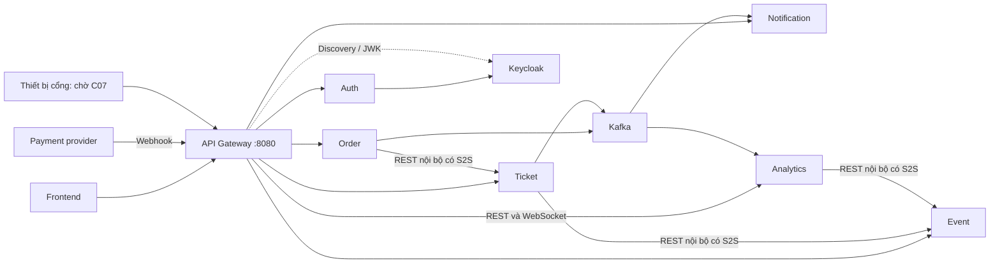
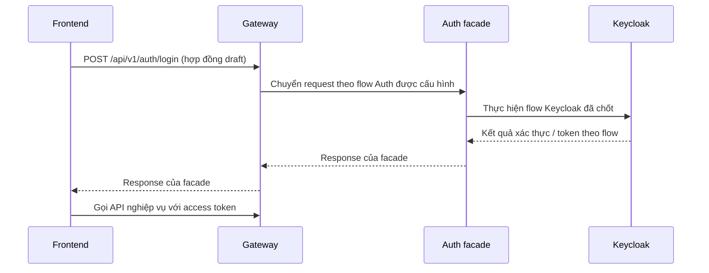
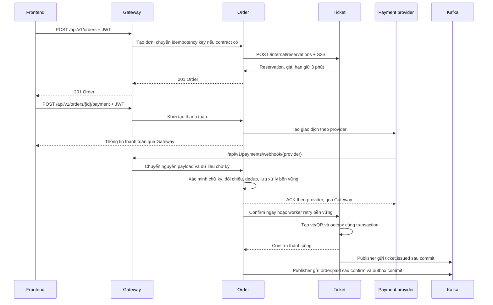
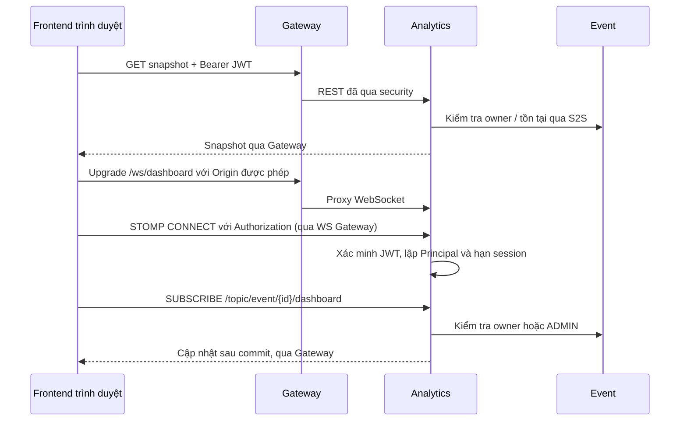

# API Gateway trong EventHub — hướng dẫn từ đầu

Cập nhật 2026-10-31. Đây là tài liệu học và thiết kế mục tiêu, **chưa phải chức năng đã triển khai**. Đọc tiếp [plan Gateway](../plans/api-gateway.md) để biết các bước code và [hợp đồng chung](../plans/00-cross-service-contracts.md) để phối hợp với sáu service nghiệp vụ.

## 1. API Gateway là gì?

API Gateway là ứng dụng đứng ở cửa vào backend: nhận request từ frontend, kiểm tra chính sách chung rồi chuyển request tới service phụ trách. Frontend chỉ cần biết một địa chỉ, ví dụ `http://localhost:8080`, thay vì tự chọn cổng của từng service.

Ví dụ người dùng xem sự kiện:

```text
Frontend gọi GET http://localhost:8080/api/v1/events
Gateway chọn Event Service
Event Service xử lý GET /api/v1/events và trả dữ liệu
Gateway chuyển response về frontend
```

Gateway không tự truy vấn bảng events, tính giá vé hay tạo đơn. Logic đó vẫn thuộc service nghiệp vụ. Nó cũng không cấp token: Keycloak là nơi quản lý identity và cấp token, Auth là facade gọi Keycloak.

Module `api-gateway` hiện chỉ có Application, starter MVC, JPA/MySQL và datasource `eventhub_gateway`; chưa có Spring Cloud Gateway, route, security hay filter. Compose còn tạo MySQL riêng cho Gateway. Cần thực hiện plan trước khi các ví dụ trong tài liệu chạy được.

## 2. Các thuật ngữ sẽ gặp

| Thuật ngữ | Hiểu trong EventHub |
|---|---|
| Route | Quy tắc chọn service đích, ví dụ các API orders → Order Service. |
| Predicate | Điều kiện chọn route: đường dẫn, HTTP method, đôi khi header. |
| Filter | Xử lý trước/sau chuyển tiếp: correlation ID, giới hạn request, log thời gian. |
| Upstream/downstream | Trong tài liệu này, downstream là service mà Gateway gọi tiếp. |
| Authentication — xác thực | Kiểm tra token có hợp lệ và người gọi là ai. |
| Authorization — phân quyền | Kiểm tra người đó được làm gì. Role ở Gateway là vòng đầu; owner kiểm tra tại service. |
| JWT | Định dạng token có chữ ký và claims như subject, issuer, hạn sử dụng; đọc được payload không có nghĩa đã xác minh. |
| Issuer / audience / JWK | Nơi cấp token / bên nhận token / khóa công khai dùng xác minh chữ ký. |
| CORS | Quy tắc trình duyệt cho phép frontend khác origin gọi API; không thay thế xác thực. |
| Reverse proxy | Thành phần nhận request rồi chuyển tới server phía sau; Gateway bổ sung chính sách API trên cơ chế này. |
| Timeout / retry | Giới hạn chờ / gọi lại; gọi lại thao tác ghi có thể tạo tác dụng phụ nếu không có idempotency. |

## 3. Gateway nằm ở đâu?



Frontend đi qua Gateway. Order gọi Ticket bằng địa chỉ nội bộ và credential service riêng. Kafka đi trực tiếp giữa producer, broker và consumer. Các service vẫn phải xác thực và kiểm tra quyền; chặn `/internal/**` tại Gateway chưa đủ nếu service đang mở cổng ra Internet.

| Thành phần | Trách nhiệm |
|---|---|
| Gateway | Route, CORS, xác thực REST, quyền theo nhóm API, correlation ID, timeout, lỗi hạ tầng. |
| Auth + Keycloak | Đăng ký/đăng nhập/quản lý tài khoản theo flow đã chốt, cấp và quản lý token/session. |
| Service nghiệp vụ | Validate DTO, owner, trạng thái, transaction, idempotency, DB, outbox. |
| Analytics WebSocket | Xác thực STOMP CONNECT, kiểm tra quyền từng SUBSCRIBE, đóng session hết hạn. |
| Reverse proxy/load balancer triển khai | TLS nếu kết thúc ở đây, phân phối tới nhiều Gateway, chỉ chuyển header proxy đáng tin. |

Gateway dự kiến chạy stateless, không cần JPA, repository, entity hay DB nghiệp vụ. Redis chỉ cần nếu triển khai rate limit dùng chung giữa nhiều instance; đây là bước sau, không là điều kiện để học routing.

## 4. Luồng đọc public và request có đăng nhập

GET danh sách sự kiện, GET chi tiết sự kiện, GET categories và GET ticket types của sự kiện là public theo OpenAPI hiện tại. Gateway cho qua đúng method/path; Event/Ticket vẫn kiểm tra điều kiện công khai dữ liệu, ví dụ sự kiện phải PUBLISHED.

```mermaid
sequenceDiagram
    participant F as Frontend
    participant G as Gateway
    participant K as Keycloak
    participant O as Order Service
    F->>G: GET /api/v1/orders/me + Bearer JWT
    opt Chưa có khóa phù hợp trong cache
        G->>K: Lấy discovery / JWK
        K-->>G: Metadata / khóa công khai
    end
    G->>G: Xác minh chữ ký, issuer, audience, thời hạn, identity/role
    alt Token sai hoặc thiếu
        G-->>F: 401 ErrorResponse
    else Identity hợp lệ nhưng thiếu quyền
        G-->>F: 403 ErrorResponse
    else Đủ quyền vào API
        G->>O: Giữ path/query và Authorization; correlation ID
        O->>O: Xác minh token, lấy userId từ Principal, đọc đơn của user
        O-->>G: Response theo OpenAPI
        G-->>F: Giữ status và body
    end
```

Với JWT, Gateway thường xác minh bằng khóa công khai đã cache, không gọi Auth để hỏi token đúng hay sai cho từng request. Khi cần lấy khóa mới mà Keycloak lỗi, request phải thất bại an toàn; không bỏ xác minh để tiếp tục. Token đã có khóa hợp lệ vẫn có thể xác minh theo chính sách cache và thời hạn. Cơ chế Resource Server/JWK được mô tả trong [Spring Security](https://docs.spring.io/spring-security/reference/6.5/reactive/oauth2/resource-server/jwt.html).

`/orders/me` lấy userId từ token đã xác minh. Client tự gửi `X-User-Id` hoặc `X-Role: ADMIN` không tạo ra quyền. Gateway loại bỏ các header identity tự khai; service không tin chúng.

## 5. Luồng đăng nhập, refresh và logout



Đây là sơ đồ trách nhiệm, không chốt grant flow. Contract login có email/password vẫn là draft; không tự bật Direct Access Grants/password grant. Nếu chọn authorization code, bước redirect/callback và contract Auth phải cập nhật trước khi route tương ứng.

POST register/login/refresh/logout không yêu cầu access JWT tại Gateway theo hợp đồng hiện tại. Riêng refresh/logout, Auth kiểm tra refresh token/session theo Keycloak. GET me và POST change-password yêu cầu access token; `/admin/users/**` yêu cầu ADMIN. Không dùng `permitAll` cho toàn bộ `/auth/**`.

Logout hoặc khóa tài khoản không mặc nhiên vô hiệu mọi JWT đã cấp ngay lập tức. TTL, thu hồi và thời gian cập nhật quyền là cấu hình Keycloak còn mở trong [danh sách quyết định](../project-clarifications.md).

## 6. Luồng mua vé và webhook



Gateway không tự reserve/confirm và không gọi lại POST tạo đơn/thanh toán/hoàn tiền khi timeout. Timeout chỉ nói rằng chưa nhận được kết quả; giao dịch có thể đã được xử lý. Client tra cứu trạng thái hoặc retry theo idempotency contract tại service.

Webhook do payment provider gọi vào, khác với API Gateway của EventHub. Provider thường không có access JWT người dùng. Ngoại lệ không yêu cầu JWT chỉ áp đúng webhook route đã cấu hình; Order bắt buộc xác minh chữ ký và dedup. C06 chưa chọn provider nên method, wire format, chữ ký và ACK còn phải hoàn thiện; POST là draft hiện hành, không tự mở mọi method.

Gateway giữ nguyên body/query/form/chữ ký, không ACK thành công thay Order. C04 refund khách cả đơn 70%, ADMIN-only; C05 hold trước provider và bù lỗi phát vé 100% đã có [thiết kế](payment-refund-recovery.md). Adapter provider C06 để sau; Gateway không tự thực hiện hoàn tiền.

## 7. Luồng dashboard WebSocket

REST GET `/api/v1/analytics/events/{id}/dashboard` lấy snapshot; WebSocket `/ws/dashboard` nhận cập nhật qua STOMP. HTTP route tới `http://...`; WS route tới `ws://...` hoặc `wss://...`. Spring Cloud Gateway có [filter chuyển tiếp WebSocket](https://docs.spring.io/spring-cloud-gateway/reference/4.3/spring-cloud-gateway-server-webflux/global-filters.html).



Trình duyệt không cho đặt tùy ý HTTP `Authorization` trên native WebSocket handshake. Phương án đề xuất là cho handshake đúng `/ws/dashboard` qua kiểm tra Origin/giới hạn kết nối, rồi Analytics bắt buộc xác thực token trong STOMP CONNECT. Header STOMP này đi bên trong kết nối, Gateway không xác thực nó như REST. Xem [Spring về token trong STOMP](https://docs.spring.io/spring-framework/reference/web/websocket/stomp/authentication-token-based.html).

Analytics phải chặn SUBSCRIBE/SEND trước CONNECT hợp lệ, timeout kết nối chưa xác thực, kiểm tra từng event khi subscribe và đóng session hết hạn token. Chặn client SEND vào topic server. Không gắn JWT vào URL; không mở `/ws/**` hoặc SockJS ngoài phạm vi. Native WebSocket là baseline đề xuất; nếu thêm SockJS phải bổ sung HTTP routes và security riêng.

Sau SUBSCRIBE thành công, frontend GET lại snapshot để hội tụ cập nhật trong khoảng nối kết; reconnect cũng làm như vậy. SimpleBroker chỉ phù hợp dev/một Analytics instance; nhiều instance cần cơ chế fanout chung theo [plan Analytics](../plans/analytics-service.md).

## 8. Nhìn route để biết request đi đâu

| Request từ client | Owner | Lưu ý |
|---|---|---|
| `/api/v1/auth/...`, `/api/v1/admin/users/...` | Auth | Quyền khác nhau theo operation. |
| `/api/v1/events`, `/api/v1/events/{id}` và submit/publish/close | Event | Owner kiểm tra trong Event. |
| `/api/v1/events/{eventId}/ticket-types` | Ticket | Route cụ thể này phải đứng trước route events rộng nếu dùng route rộng. |
| `/api/v1/categories...`, `/api/v1/organizer/events`, `/api/v1/admin/events/{id}/review` | Event | GET categories public; ghi categories dành ADMIN. |
| `/api/v1/ticket-types...`, `/api/v1/tickets...`, `/api/v1/gate/...` | Ticket | Thiết bị cổng cần identity riêng, chờ C07. |
| `/api/v1/orders...`, `/api/v1/payments/webhook/{provider}`, `/api/v1/admin/refunds...` | Order | Webhook có cơ chế xác thực riêng. |
| `/api/v1/notifications...`, `/api/v1/admin/notification-templates...` | Notification | Các route admin không cùng owner service. |
| `/api/v1/analytics/events/{id}/...`, `/ws/dashboard` | Analytics | Tách REST và WS. |
| `/internal/**`, `/api/v1/internal/**` | Không chuyển tiếp | Chỉ gọi trực tiếp trong mạng nội bộ với S2S. |

Không route toàn bộ `/api/v1/admin/**` về một service. Không thêm `StripPrefix=2` nếu controller đã nhận `/api/v1/...`: các OpenAPI public dùng server URL có `/api/v1`, path bên dưới là phần còn lại. Giữ nguyên query `page`, `size`, `sort` và body/response theo contract.

## 9. Công nghệ và ví dụ route tối thiểu

Đề xuất Spring Cloud Gateway Server WebFlux vì repo dùng Java/Spring. Boot hiện tại là `3.5.16`; bảng [tương thích Spring Cloud](https://spring.io/projects/spring-cloud/) ghép Boot 3.5.x với Cloud 2025.0.x. Khi code phải khóa bản vá BOM cụ thể và kiểm tra tình trạng hỗ trợ; tài liệu không nâng Boot hay mặc định chọn Gateway 5.x. Gateway WebFlux dùng Reactor/Netty theo [starter 4.3](https://docs.spring.io/spring-cloud-gateway/reference/4.3/spring-cloud-gateway-server-webflux/starter.html).

Ví dụ bean Java **minh họa hai route**, chưa đủ security và toàn bộ API để triển khai:

```java
@Bean
RouteLocator exampleRoutes(RouteLocatorBuilder builder) {
    return builder.routes()
        .route("ticket-types-public", r -> r
            .path("/api/v1/events/{eventId}/ticket-types").and().method("GET")
            .uri("http://localhost:8083"))
        .route("event-list-public", r -> r
            .path("/api/v1/events").and().method("GET")
            .uri("http://localhost:8082"))
        .build();
}
```

`path` và `method` là predicates; `uri` là service đích. Ví dụ không rewrite path. Trong Docker thay `localhost:8082` bằng `event-service:8080`, vì localhost bên trong container là chính container Gateway. Lớp MVC của các service phía sau vẫn dùng được; chỉ Gateway chuyển sang WebFlux và tránh gọi blocking trên event loop.

## 10. Cách học và chạy thử khi đã implement

1. Đọc mục 1–3, theo dấu một GET public từ frontend tới Event.
2. Dùng bảng route trong plan để bổ sung từng service; kiểm tra riêng ticket types và các route admin.
3. Tích hợp Keycloak: gọi `/orders/me` với token thiếu, sai, hết hạn, đúng quyền; kiểm tra owner ở service.
4. Tạo đơn/thanh toán ở sandbox; xem Gateway chỉ chuyển tiếp, còn Order điều phối Ticket và provider.
5. Nối dashboard: phân biệt HTTP Upgrade, STOMP CONNECT và SUBSCRIBE.

Các lệnh sau là ví dụ kiểm tra sau triển khai, chạy PowerShell từ root repo. Backend tương ứng và cấu hình identity phải sẵn sàng:

```powershell
curl.exe -i http://localhost:8080/api/v1/events
curl.exe -i http://localhost:8080/api/v1/orders/me
curl.exe -i http://localhost:8080/internal/events/00000000-0000-0000-0000-000000000001
# Nhập token thử nghiệm vào biến môi trường ở máy cá nhân trước khi gọi:
curl.exe -i -H "Authorization: Bearer $env:EVENTHUB_ACCESS_TOKEN" http://localhost:8080/api/v1/orders/me
```

GET public kỳ vọng theo OpenAPI; `/orders/me` thiếu token trả 401; internal không được tới downstream (status từ lớp security/deny theo plan). Các lệnh trên chưa chứng minh checkout/payment đúng nghiệp vụ.

| Hiện tượng | Kiểm tra trước |
|---|---|
| 404 | Route/method đã khai báo chưa, path có bị bỏ prefix không, controller đích có tồn tại chưa? |
| 401 | Thiếu/sai/hết hạn JWT, issuer/audience, JWK; refresh/logout có được miễn access JWT đúng method/path chưa? |
| 403 | Role mapping, owner tại service; với WS kiểm tra CONNECT/SUBSCRIBE và Origin. |
| 502/503 | DNS/port downstream, service chưa chạy, connection hoặc identity dependency lỗi. |
| 504 | Downstream chưa trả đúng thời hạn; tra cứu trạng thái trước khi retry thao tác ghi. |
| Trình duyệt báo CORS nhưng curl gọi được | Origin/method/header và preflight OPTIONS có được cho phép không? |
| WS không upgrade được | Route `ws://`, proxy Upgrade, Origin và cấu hình handshake. |
| WS đã nối nhưng không có dữ liệu | JWT CONNECT, destination SUBSCRIBE, quyền owner, token hết hạn, Kafka/projection. |

## 11. Những việc cần chốt trước khi vận hành

Issuer/audience/JWK/role mapping và S2S theo cấu hình Keycloak; flow Auth; provider C06; quyền thiết bị C07; origin frontend và topology TLS/proxy; timeout/giới hạn request theo môi trường. Các giá trị này phải được cấu hình và kiểm tra, không tự xem là đã chốt chỉ vì có Gateway.

Tiếp theo: [plan triển khai Gateway](../plans/api-gateway.md), [hợp đồng API](../api/README.md), [luồng hệ thống](README.md).
