# Auth Service ↔ Keycloak: Request Flow Diagrams

Mỗi diagram minh họa luồng request từ **Frontend → Auth Service (Facade) → Keycloak** cho từng use case. Auth Service **không tự ký JWT, không lưu password/refresh token** — chỉ proxy gọi Keycloak Admin REST API và OIDC endpoints.

---

## 1. Đăng ký (Register) — `POST /api/v1/auth/register`

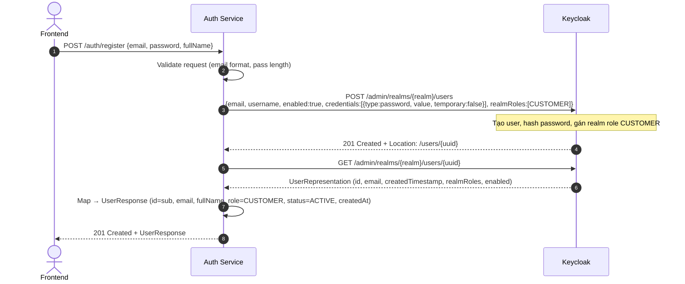

**Key Points:**
- Auth Service **không hash password** — gửi plaintext qua TLS tới Keycloak Admin API
- Keycloak tự hash (PBKDF2/Argon2 theo config), lưu credential
- Role `CUSTOMER` gán mặc định ở Auth Service, **không tin role từ request FE**
- `userId` trả về = Keycloak `sub` (UUID)

---

## 2. Đăng nhập (Login) — `POST /api/v1/auth/login`

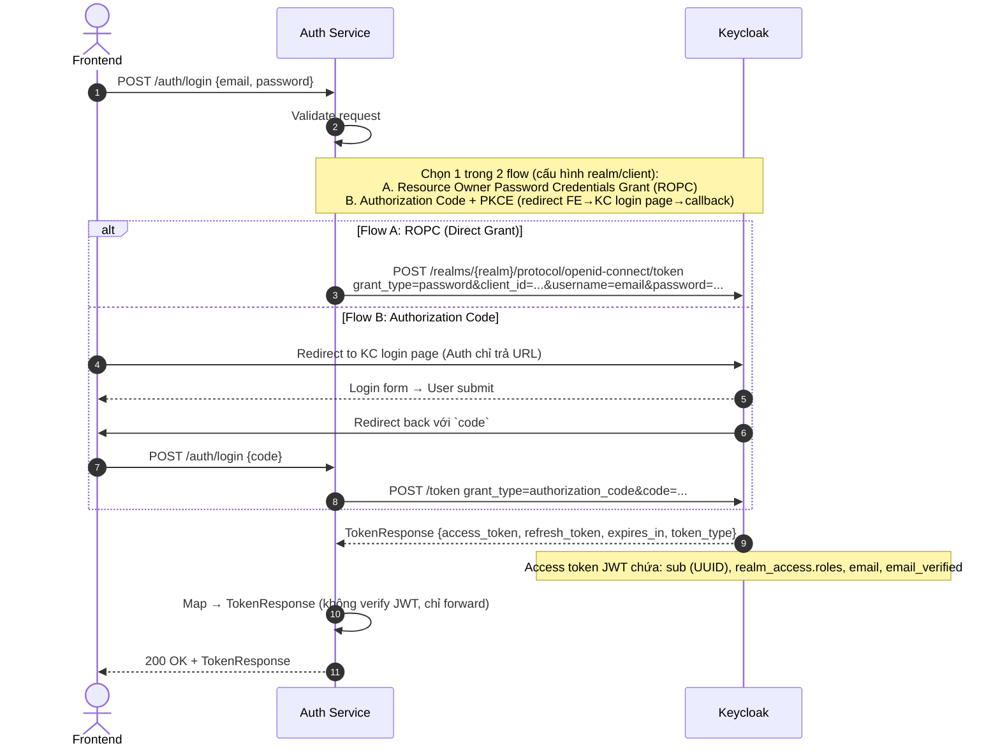

**Key Points:**
- **Flow A (ROPC)**: FE gửi email/password thẳng → Auth proxy tới KC token endpoint. **Cần bật Direct Access Grants trên client KC**.
- **Flow B (Auth Code + PKCE)**: An toàn hơn, FE redirect về KC login page. Auth chỉ proxy code exchange.
- Keycloak **cấp token**, Auth **không ký JWT**.
- Access token JWT chứa `sub` (UUID), `realm_access.roles`, `email`, `email_verified`.

---

## 3. Refresh Token — `POST /api/v1/auth/refresh`

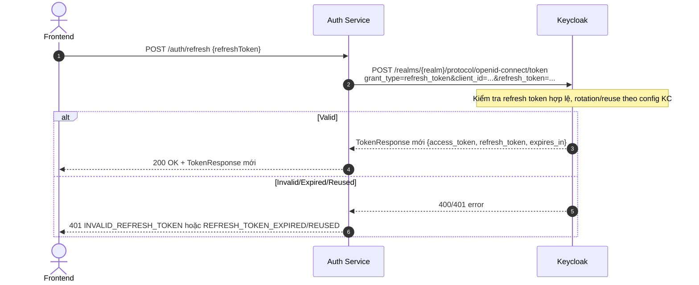

**Key Points:**
- Auth **không lưu refresh token local** — hoàn toàn delegate cho Keycloak
- Rotation/reuse policy do Keycloak config (không phải code Auth)
- Nếu reused → Keycloak revoke toàn bộ token family

---

## 4. Đăng xuất (Logout) — `POST /api/v1/auth/logout`

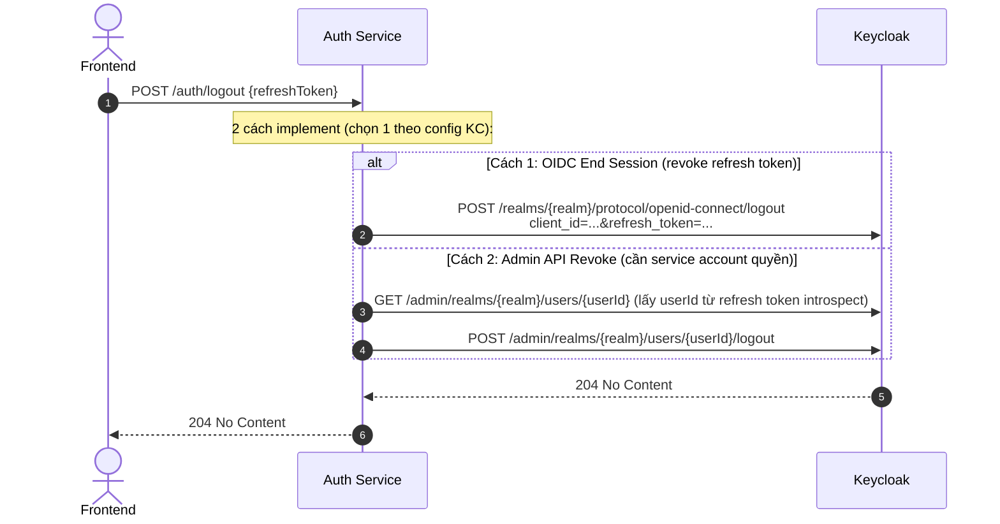

**Key Points:**
- Không chỉ xóa token FE — phải revoke ở Keycloak
- Access token đã cấp vẫn hợp lực đến khi hết hạn (trừ khi config token revocation + resource server check introspection)

---

## 5. Lấy Profile (Me) — `GET /api/v1/auth/me`

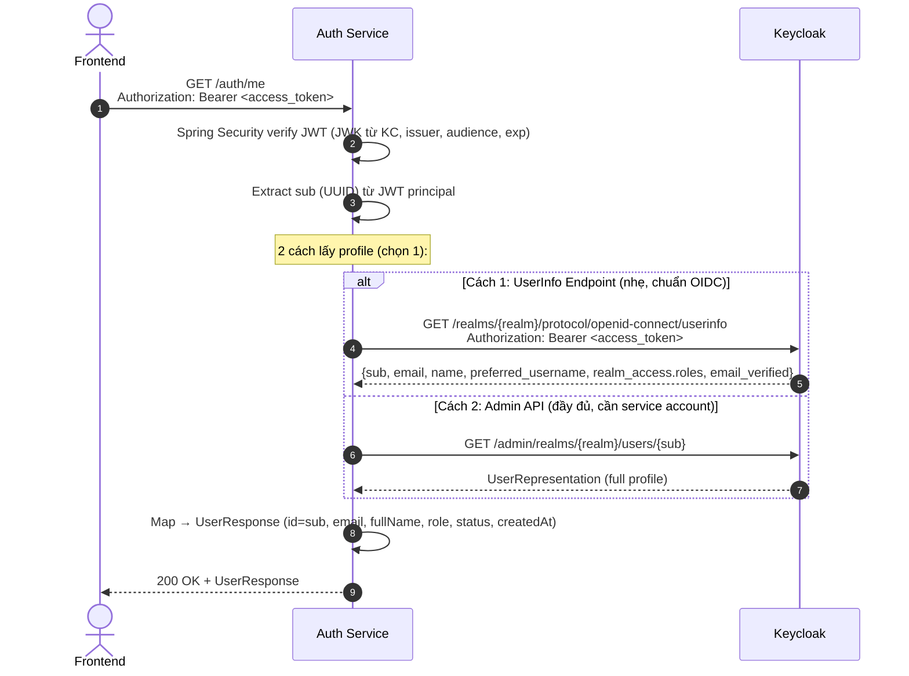

**Key Points:**
- **Không query DB local** — Keycloak là source of truth
- `role` = map từ `realm_access.roles` (chỉ lấy CUSTOMER/ORGANIZER/ADMIN)
- `status` = map từ `enabled` (true=ACTIVE, false=LOCKED)
- `createdAt` = `createdTimestamp` từ Keycloak

---

## 6. Đổi Mật Khẩu (User Self) — `POST /api/v1/auth/change-password`

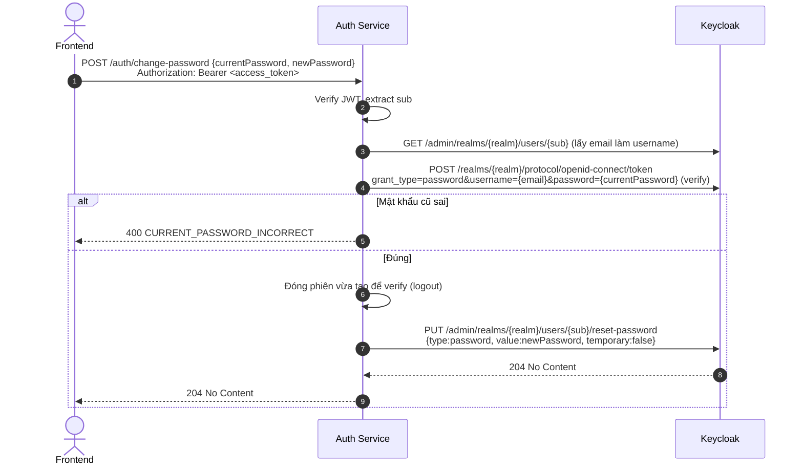

**Key Points:**
- **Không so sánh hash local** — delegate verify cho Keycloak bằng password grant
- Lần verify tạo ra một phiên thật rồi **đóng ngay** để không rác session
- Mật khẩu cũ sai **tính vào brute-force của realm** giống đăng nhập thường — đây là chủ đích
- Dùng Admin API (`reset-password`) chứ không dùng Account API vì Auth Service đã có service account; tránh phải forward access token của user
- Mật khẩu mới không đạt chính sách realm → **400 `VALIDATION_ERROR`**
- **Không thu hồi phiên khác**: user đổi mật khẩu xong vẫn giữ các phiên đang mở. Nếu muốn đuổi hết thì gọi thêm `logoutAllSessions` (chưa làm)

---

## 7. Quên Mật Khẩu (Forgot Password) — `POST /api/v1/auth/forgot-password`

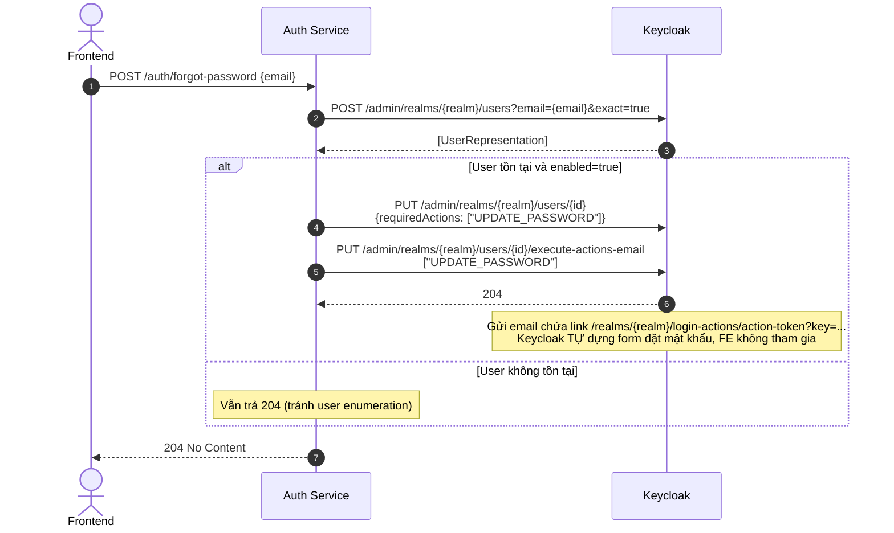

**Key Points:**
- **Luôn trả 204** dù email có tồn tại hay không (security: anti-enumeration)
- Tài khoản `enabled=false` cũng trả 204 nhưng **không gửi mail**
- Phải gắn `requiredActions: ["UPDATE_PASSWORD"]` trước khi gọi `execute-actions-email`; thiếu bước này mail vẫn đi nhưng bấm link sẽ không vào bước đặt mật khẩu
- Keycloak tự xử lý email template, token reset, expiry
- Link trỏ thẳng tới Keycloak (`KC_HOSTNAME`), **không** redirect về FE — xem lý do ở §8

---

## 8. Reset Mật Khẩu (User) — KHÔNG triển khai

Auth Service **cố ý không mở** `POST /api/v1/auth/reset-password {resetToken, newPassword}`.

**Lý do:** token đặt lại mật khẩu do Keycloak sinh và ký. Auth Service không có khóa để kiểm chứng token đó, cũng không có API nào của Keycloak để "đổi token thành userId" một cách an toàn. Nếu mở endpoint nhận `resetToken`, Auth Service buộc phải tin một chuỗi do client gửi lên — đúng lỗ hổng leo thang đặc quyền: kẻ tấn công đoán/đánh cắp token là đổi được mật khẩu người khác.

**Cách làm thay thế:** link trong mail (§7) trỏ thẳng tới Keycloak:

```
http://localhost:8180/realms/eventhub/login-actions/action-token?key=<token>
```

Keycloak tự kiểm token, tự dựng form đặt mật khẩu, tự cập nhật credential và xoá `requiredActions`. Toàn bộ nằm trong một hệ thống giữ khóa — không có bước nào Auth Service phải tin dữ liệu từ client.

**Nếu sau này vẫn cần FE tự dựng form**, hướng đúng là dùng **Keycloak Account REST API** với access token của chính user (`POST /realms/{realm}/account/credentials/password`), không phải endpoint riêng của Auth Service.

---

## 9. Admin: Danh Sách User — `GET /api/v1/admin/users`

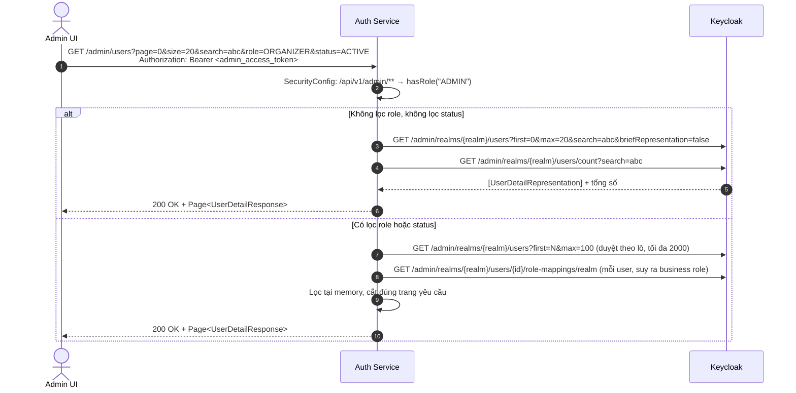

**Key Points:**
- Chỉ ADMIN truy cập — chặn ở **`SecurityConfig.requestMatchers("/api/v1/admin/**").hasRole("ADMIN")`**, dự án **không dùng `@PreAuthorize`** ở bất kỳ controller nào
- `search` đẩy xuống Keycloak (khớp email/họ tên/username); `role` và `status` **không** lọc được bằng query param của Keycloak nên phải duyệt theo lô ở Auth Service
- Duyệt có trần 2000 bản ghi/lần để một bộ lọc hiếm không kéo theo hàng nghìn lệnh gọi mạng; vượt trần thì ghi log WARN và trả kết quả một phần
- Pagination: `page` (0-based) × `size` → `first`/`max`
- Tham số rác được **chuẩn hóa thay vì trả lỗi**: `page` âm → 0, `size` > 100 → 100, `status` lạ → bỏ qua
- Response là `PageResponse<T>(content, page, size, totalElements, totalPages)`

---

## 10. Admin: Chi Tiết User — `GET /api/v1/admin/users/{userId}`

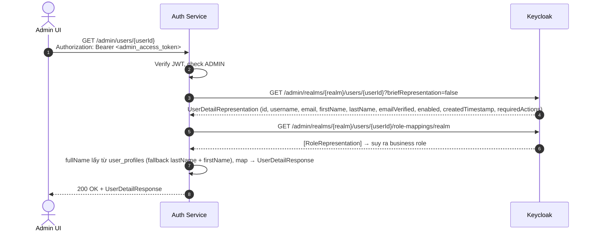

**UserDetailResponse:**
```json
{
  "id": "d26f343f-81d4-4d4a-a3d3-2b3b03957cfa",
  "username": "test.postman@eventhub.local",
  "email": "test.postman@eventhub.local",
  "fullName": "Nguyễn Postman",
  "role": "CUSTOMER",
  "status": "ACTIVE",
  "emailVerified": true,
  "requiredActions": ["UPDATE_PASSWORD"],
  "createdAt": "2026-11-21T08:31:16.409Z"
}
```

**Key Points:**
- `requiredActions` cho FE biết user còn bước nào chưa xong (`VERIFY_EMAIL`, `UPDATE_PASSWORD`…)
- **Không có `lastLoginAt`**: Keycloak Admin API không trả về thời điểm đăng nhập cuối, phải đọc từ event log của realm. Nếu cần thì đây là việc riêng, không thuộc endpoint này
- Không tồn tại → **404 `USER_NOT_FOUND`**; id sai định dạng → **400 `VALIDATION_ERROR`**

---

## 11. Admin: Khóa/Mở Khóa — `PATCH /admin/users/{userId}/lock|unlock`

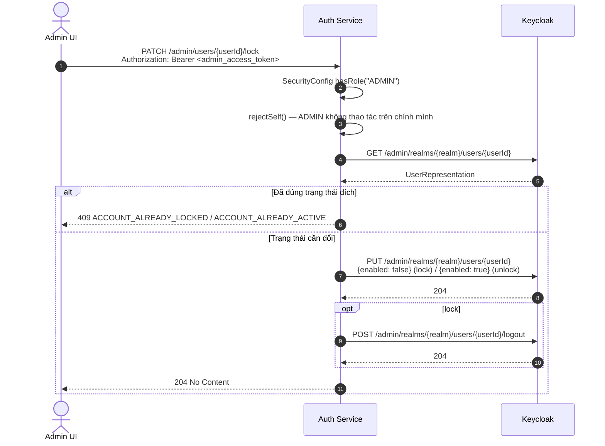

**Key Points:**
- Lock = `enabled=false` **+ revoke toàn bộ session**; unlock = `enabled=true` (không đụng session)
- **KHÔNG idempotent**: gọi lại khi đã đúng trạng thái → **409** (`ACCOUNT_ALREADY_LOCKED` / `ACCOUNT_ALREADY_ACTIVE`). Chủ đích: ADMIN biết thao tác của mình không có tác dụng, tránh hiểu nhầm là vừa khóa được một tài khoản khác
- ADMIN tự khóa mình → **409 `CANNOT_MODIFY_OWN_ACCOUNT`**
- Access token đã cấp vẫn dùng được tới khi hết hạn (5 phút); refresh token thì chết ngay
- Keycloak chỉ trả `"Account disabled"` khi **mật khẩu đúng**; sai mật khẩu luôn trả `"Invalid user credentials"` — đây là hành vi chống dò tài khoản của Keycloak, không phải bug

---

## 12. Admin: Gán Role — `PATCH /admin/users/{userId}/role`

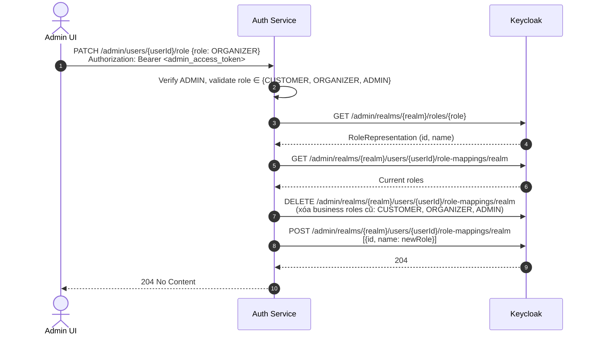

**Key Points:**
- Chỉ map **business roles** (CUSTOMER/ORGANIZER/ADMIN)
- **Không xóa role kỹ thuật** của Keycloak (default-roles, offline_access, uma_authorization...)
- Xóa business roles cũ → thêm role mới (replace)

---

## 13. Admin: Reset Password User Khác — `POST /admin/users/{userId}/reset-password`

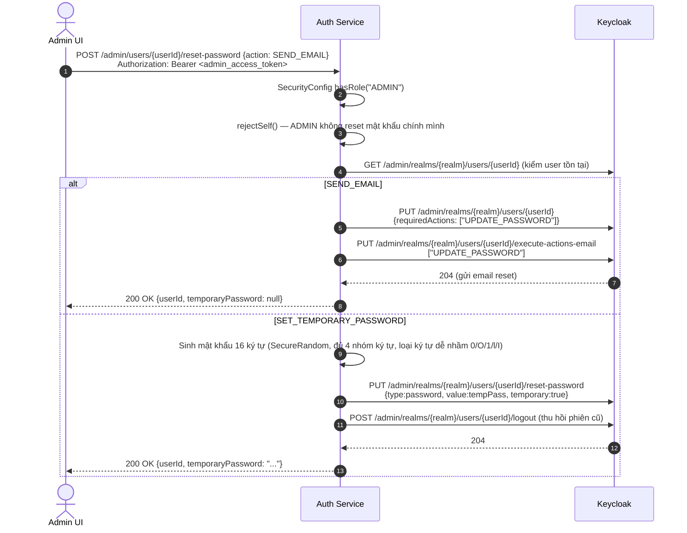

**Key Points:**
- Mật khẩu tạm **chỉ trả đúng một lần** trong response, không lưu DB, không ghi log — ADMIN phải tự chuyển cho user
- Vì `temporary: true`, Keycloak gắn `requiredActions: ["UPDATE_PASSWORD"]`; user đăng nhập bằng mật khẩu tạm sẽ bị bắt đổi ngay
- Đăng nhập bằng mật khẩu tạm trả **403 `ACCOUNT_LOCKED`** với message `"Account requires further setup"` — mã lỗi gây hiểu nhầm (xem phần "Lỗi đã biết")
- `SET_TEMPORARY_PASSWORD` thu hồi toàn bộ phiên cũ vì mật khẩu vừa đổi
- `action` không thuộc enum → **400 `VALIDATION_ERROR`**

---

## 14. Quản Lý Session

### 14.1. User tự quản lý session của mình — ĐÃ TRIỂN KHAI

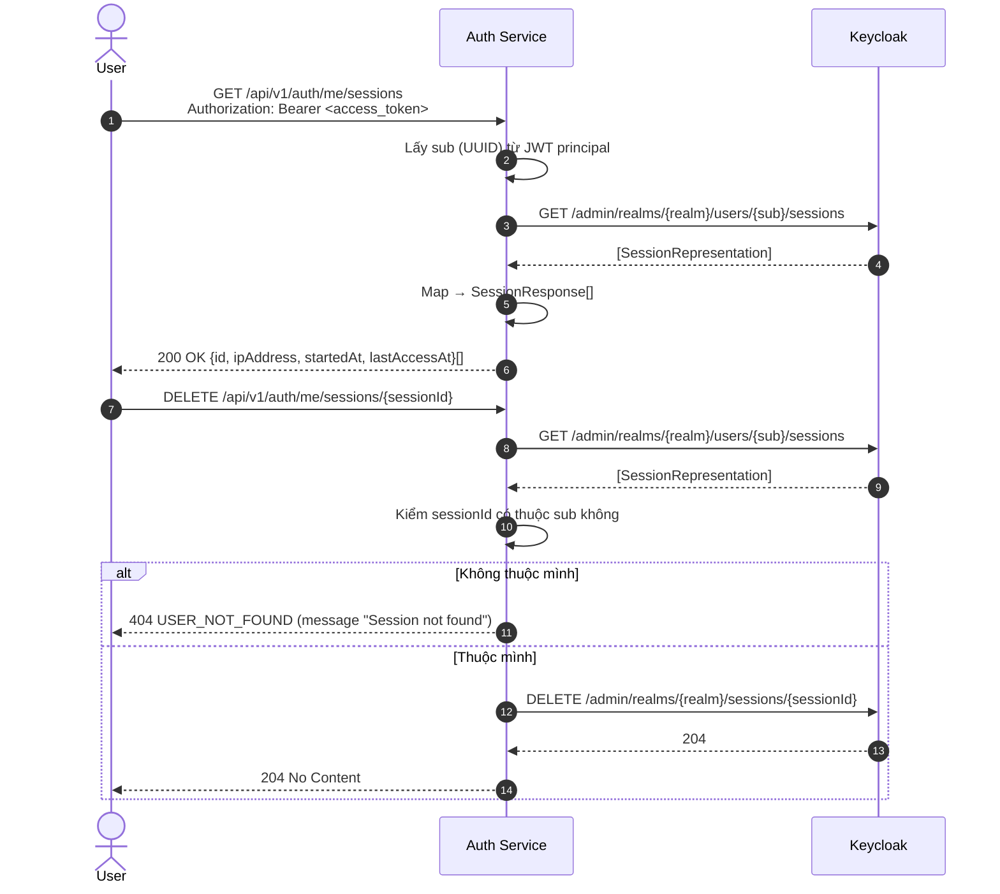

**Response mẫu:**
```json
[
  {
    "id": "ScX2A4mz5dpG7VLEyhFSDZbR",
    "ipAddress": "172.20.0.1",
    "startedAt": "2026-11-21T13:01:11Z",
    "lastAccessAt": "2026-11-21T13:01:11Z"
  }
]
```

**Key Points:**
- Phải kiểm quyền sở hữu: `sessionId` do Keycloak sinh và khó đoán, nhưng không kiểm thì user A thu hồi được phiên user B
- Thu hồi phiên **không** làm access token đang lưu hành mất hiệu lực ngay — token sống tới khi hết hạn (5 phút)
- Keycloak trả `clients` là **map clientId → tên client**, không phải số lượng; DTO phải khai đúng kiểu, sai kiểu sẽ làm Jackson ném lỗi và endpoint trả 503

### 14.2. Admin quản lý session của user khác — CHƯA TRIỂN KHAI

| Endpoint dự kiến | Keycloak API | Trạng thái |
|---|---|---|
| `GET /api/v1/admin/users/{userId}/sessions` | `GET /admin/realms/{realm}/users/{userId}/sessions` | 🔲 Chưa làm |
| `DELETE /api/v1/admin/users/{userId}/sessions` | `DELETE /admin/realms/{realm}/users/{userId}/sessions` | 🔲 Chưa làm |

Hiện ADMIN chỉ có thể đuổi user ra khỏi mọi phiên **gián tiếp** qua `PATCH /admin/users/{userId}/lock` (khóa tài khoản + thu hồi session). Nếu cần đuổi phiên mà không khóa tài khoản thì mới phải thêm 2 endpoint trên.

---

## Tổng Hợp: Mapping Endpoint ↔ Keycloak API

Bảng dưới đây là **danh sách đầy đủ 17 endpoint đang chạy thật** trong `auth-service`. Đối chiếu với code bằng:

```bash
grep -rn 'Mapping' auth-service/src/main/java/com/eventhub/auth/controller/
```

| Auth Endpoint | Keycloak Admin API / OIDC Endpoint | Ghi chú |
|---------------|-------------------------------------|---------|
| `POST /auth/register` | `POST /admin/users` + `GET /admin/users/{id}` + `PUT /admin/users/{id}` + `PUT /admin/users/{id}/execute-actions-email` | Tạo user + gán CUSTOMER + tạo profile + gửi mail xác minh. Lỗi giữa chừng → xoá user vừa tạo (compensation) |
| `POST /auth/login` | `POST /protocol/openid-connect/token` (password) | ROPC — Direct Access Grants |
| `POST /auth/refresh` | `POST /protocol/openid-connect/token` (refresh_token) | Delegate rotation cho KC |
| `POST /auth/logout` | `POST /protocol/openid-connect/logout` | Revoke session bằng refresh token |
| `GET /auth/me` | `GET /admin/users/{id}` + `GET /admin/users/{id}/role-mappings/realm` | Lấy profile từ KC (không dùng userinfo) |
| `POST /auth/change-password` | `POST /protocol/openid-connect/token` (verify) → `PUT /admin/users/{id}/reset-password` | Verify mật khẩu cũ bằng password grant, không so hash local |
| `POST /auth/forgot-password` | `GET /admin/users?email=&exact=true` + `PUT /admin/users/{id}` + `PUT /admin/users/{id}/execute-actions-email` ["UPDATE_PASSWORD"] | Luôn 204 |
| `POST /auth/verify-email/resend` | `PUT /admin/users/{id}` + `PUT /admin/users/{id}/execute-actions-email` ["VERIFY_EMAIL"] | 409 nếu đã xác thực |
| `GET /auth/me/sessions` | `GET /admin/users/{id}/sessions` | Session của mình |
| `DELETE /auth/me/sessions/{sessionId}` | `GET /admin/users/{id}/sessions` + `DELETE /admin/sessions/{sessionId}` | Kiểm quyền sở hữu trước khi xoá |
| `GET /me/profile` | — | Đọc từ `user_profiles` (DB local) |
| `PUT /me/profile` | — | Khởi tạo profile; 409 nếu đã có |
| `PATCH /me/profile` | — | Cập nhật một phần |
| `GET /admin/users` | `GET /admin/users` (paginated) + `GET /admin/users/count` | List + phân trang + lọc `search`/`role`/`status` |
| `GET /admin/users/{id}` | `GET /admin/users/{id}` + `GET /admin/users/{id}/role-mappings/realm` | Chi tiết user |
| `POST /admin/users/{id}/reset-password` | `PUT /admin/users/{id}/execute-actions-email` HOẶC `PUT /admin/users/{id}/reset-password` + `POST /admin/users/{id}/logout` | `SEND_EMAIL` / `SET_TEMPORARY_PASSWORD` |
| `PATCH /admin/users/{id}/lock` | `PUT /admin/users/{id}` {enabled:false} + `POST /admin/users/{id}/logout` | Disable + revoke |
| `PATCH /admin/users/{id}/unlock` | `PUT /admin/users/{id}` {enabled:true} | Enable |
| `PATCH /admin/users/{id}/role` | `DELETE/POST /admin/users/{id}/role-mappings/realm` | Replace business role |

**Chưa triển khai (có trong kế hoạch, KHÔNG có trong code):**

| Endpoint | Lý do |
|---|---|
| `POST /auth/reset-password` | Xem §8 — cố ý không mở |
| `GET /admin/users/{id}/sessions` | Xem §14.2 — chưa làm |
| `DELETE /admin/users/{id}/sessions` | Xem §14.2 — chưa làm |

---

## Cấu Hình Keycloak Hiện Tại (đã chạy thật)

Nguồn sự thật: [`infrastructure/keycloak/eventhub-realm.json`](../../infrastructure/keycloak/eventhub-realm.json). Realm import tự động khi container khởi động.

| Cấu hình | Giá trị thật | Trạng thái |
|----------|--------------|------------|
| Realm `eventhub` | — | ✅ Đã có |
| Client `eventhub-auth-service` (confidential) | `directAccessGrants=true`, `serviceAccounts=true`, `standardFlow=false` | ✅ Đã có |
| Client `eventhub-frontend` (public) | `standardFlow=true`, redirect `http://localhost:3000/*` | ✅ Đã có |
| Client `eventhub-order/ticket/analytics/event-service` | confidential, cho service-to-service | ✅ Đã có |
| Service Account cho `eventhub-auth-service` | Quyền `manage-users`, `view-users`, `view-realm` | ✅ Đã cấp |
| Realm Roles: `CUSTOMER`, `ORGANIZER`, `ADMIN` | — | ✅ Đã có |
| `sub` là UUID | `registrationEmailAsUsername=true` | ✅ Đúng |
| Direct Access Grants | **BẬT** (cần cho ROPC) | ✅ Theo thiết kế |
| Access token lifespan | **300s** (5 phút) | ✅ |
| SSO session idle / max | **604800s** (7 ngày) | ✅ |
| Refresh token rotation | `revokeRefreshToken=true`, `refreshTokenMaxReuse=0` | ✅ Dùng lại là chết cả family |
| Brute force detection | `bruteForceProtected=true`, `failureFactor=5` | ✅ |
| `resetPasswordAllowed` | true | ✅ |
| `verifyEmail` | false — xác minh email ép bằng `requiredActions` chứ không chặn đăng nhập | ⚠️ Theo thiết kế, nhưng gây lỗi `ACCOUNT_LOCKED` khó hiểu |
| Email template `verifyEmail` / `resetPassword` | Mặc định của Keycloak | 🔲 Chưa tùy chỉnh |
| CORS | Chưa cấu hình — dự kiến đi qua API Gateway | 🔲 |

---

## Lỗi Đã Biết (chấp nhận tạm)

| # | Hiện tượng | Nguyên nhân | Ảnh hưởng |
|---|---|---|---|
| 1 | Path không tồn tại trả **403** thay vì 404 | `.anyRequest().denyAll()` bắt cả request không khớp mapping | FE hiển thị "không có quyền" thay vì "không tìm thấy" |
| ~~2~~ | ~~Đăng nhập khi còn `requiredActions` trả `ACCOUNT_LOCKED`~~ | **Đã sửa 2026-11-21**: trả mã riêng `EMAIL_NOT_VERIFIED` (403) | — |
| 3 | `avatarUrl` không được chuẩn hóa `""` → `NULL` như `phoneNumber` | Thiếu bước normalize trong `UserProfileMapper` | DB có thể chứa chuỗi rỗng thay vì NULL |

### Đã sửa 2026-11-21

Ba lỗi do review bên ngoài chỉ ra, đều đã tái hiện và sửa:

| # | Lỗi | Bằng chứng tái hiện | Cách sửa |
|---|---|---|---|
| 1 | **Ai biết email cũng khoá được tài khoản người khác.** `sendUpdatePasswordEmail` gọi `PUT /users/{id}` với `requiredActions=[UPDATE_PASSWORD]` **trước** khi gửi mail. Vì `forgot-password` công khai, kẻ lạ chỉ cần gọi là nạn nhân bị `Account is not fully set up` dù mật khẩu đúng | Đã tái hiện trên Keycloak thật: PUT xong → login với mật khẩu đúng trả `invalid_grant: Account is not fully set up`. Chỉ cần gọi `execute-actions-email` **một mình** thì user vẫn đăng nhập được | Bỏ dòng PUT. Action đã có sẵn trong link do `execute-actions-email` tạo |
| 2 | **Chưa xác minh email thì không đăng nhập được**, trái quyết định nghiệp vụ (order-service mới là nơi chặn bằng `EMAIL_NOT_VERIFIED`) | `sendVerifyEmail` cũng gắn `requiredActions=[VERIFY_EMAIL]` trước | Bỏ dòng PUT, giữ `send-verify-email`. Đã kiểm: user `emailVerified=false` **đăng nhập được** |
| 3 | **`ACCOUNT_LOCKED` báo nhầm cho user chưa xác minh** | Case `not fully set up` map chung với `disabled`/`locked` | Tách thành `EMAIL_NOT_VERIFIED` (403). Ba case giờ phân biệt: `EMAIL_NOT_VERIFIED` / `ACCOUNT_LOCKED` / `INVALID_CREDENTIALS` |
| 4 | **`/auth/forgot-password` không giới hạn số lần** → spam hộp thư người khác | Gọi 6 lần → 6 mail | Thêm `EmailRateLimiter`: 3 mail / 15 phút / email. Đã kiểm: gọi 5 lần → đúng 3 mail |
| 5 | **Admin list gọi Keycloak quá nhiều lần** — `toResponse` gọi `effectiveRealmRoles` + 1 truy vấn DB cho **từng** user; lọc role/status duyệt tới 2000 user | Code cũ | Đẩy lọc xuống Keycloak: `enabled` cho `/users` + `/users/count`, `/roles/{role}/users` cho role; DB gom thành 1 truy vấn `findAllByKeycloakSubIn`. `search`+`role` mới cần duyệt (giới hạn 2000) |
| 6 | **Cấu hình realm thiếu quyền `view-realm`** → `/roles/{role}/users` trả 403, admin lọc theo role ra 503 | Đã gặp khi test: `listUsersByRole(ORGANIZER) failed ... 403 Forbidden` | Thêm `view-realm` vào `infrastructure/keycloak/eventhub-realm.json` |

### Điểm cần biết khi dùng các API lọc này

Kiểm trên Keycloak 26.8.2:

| Điều | Thực tế |
|---|---|
| `users?search=` | Khớp **prefix**, không phải substring. `search=eventhub.local` ra 0, `search=eventhub` mới ra |
| `users?enabled=` | Hoạt động, cả `/users` lẫn `/users/count` |
| `roles/{role}/users/count` | **Không tồn tại** (404). Phải đếm bằng `max` lớn |
| `roles/{role}/users?enabled=` | Tham số bị **bỏ qua** — trả cả user đang khoá. Phải lọc tại chỗ |
| `roles/{role}/users?search=` | Không nhận. Phải lọc tại chỗ |
| `roles/{role}/users` | Cần quyền `view-realm` trên client role của `realm-management` |

---

## Lưu Ý Triển khai Auth Service

1. **Không tự tạo JWT** — chỉ forward token từ Keycloak
2. **Không lưu password/refresh token** — delegate hoàn toàn cho Keycloak
3. **Spring Security Resource Server** verify JWT bằng JWK từ `issuer-uri` (`/.well-known/openid-configuration`)
4. **IdentityMapper** convert JWT → `Actor(UUID userId, BusinessRole role)` cho các service khác
5. **Error mapping**: Keycloak error → EventHub `ErrorResponse` (code, message, timestamp, path)
6. **Timeout**: `SimpleClientHttpRequestFactory` với **connect 3s, read 10s** (`KeycloakUserClient`, `KeycloakTokenClient`)
7. **Retry**: **Không retry** ở tầng client. Lỗi mạng → `503 AUTH_PROVIDER_UNAVAILABLE` để caller tự quyết định
8. **Audit log**: Hiện chỉ log ở mức `INFO` cho các thao tác nhạy cảm (`Admin {id} set a temporary password for user {id}`, `Password reset requested...`). **Chưa** có audit log đầy đủ cho mọi admin action
9. **Không bọc gọi Keycloak trong `@Transactional`** — Keycloak không tham gia transaction của DB. Thao tác nhiều bước phải tự bù trừ (vd `deleteUserQuietly` khi register thất bại giữa chừng)
10. **Token sống 5 phút** — mọi tài liệu test tay phải dùng script tự đăng nhập lại, không dán token cứng
