# Auth Service ↔ Keycloak: Request Flow Diagrams

Mỗi diagram minh họa luồng request từ **Frontend → Auth Service (Facade) → Keycloak** cho từng use case. Auth Service **không tự ký JWT, không lưu password/refresh token** — chỉ proxy gọi Keycloak Admin REST API và OIDC endpoints.

---

## 1. Đăng ký (Register) — `POST /api/v1/auth/register`

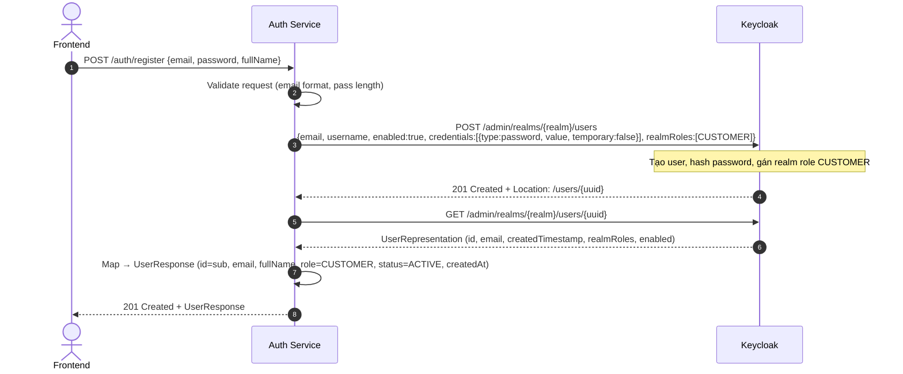

**Key Points:**
- Auth Service **không hash password** — gửi plaintext qua TLS tới Keycloak Admin API
- Keycloak tự hash (PBKDF2/Argon2 theo config), lưu credential
- Role `CUSTOMER` gán mặc định ở Auth Service, **không tin role từ request FE**
- `userId` trả về = Keycloak `sub` (UUID)

---

## 2. Đăng nhập (Login) — `POST /api/v1/auth/login`

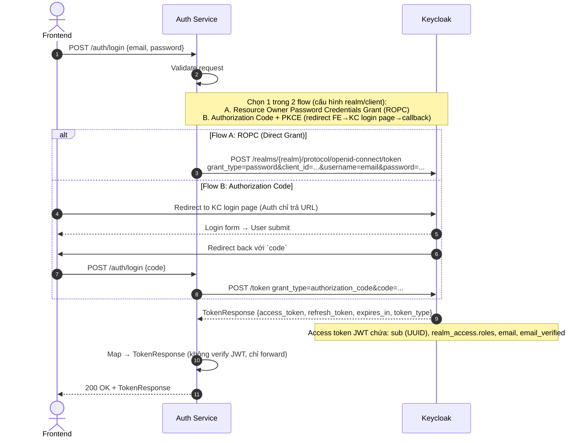

**Key Points:**
- **Flow A (ROPC)**: FE gửi email/password thẳng → Auth proxy tới KC token endpoint. **Cần bật Direct Access Grants trên client KC**.
- **Flow B (Auth Code + PKCE)**: An toàn hơn, FE redirect về KC login page. Auth chỉ proxy code exchange.
- Keycloak **cấp token**, Auth **không ký JWT**.
- Access token JWT chứa `sub` (UUID), `realm_access.roles`, `email`, `email_verified`.

---

## 3. Refresh Token — `POST /api/v1/auth/refresh`

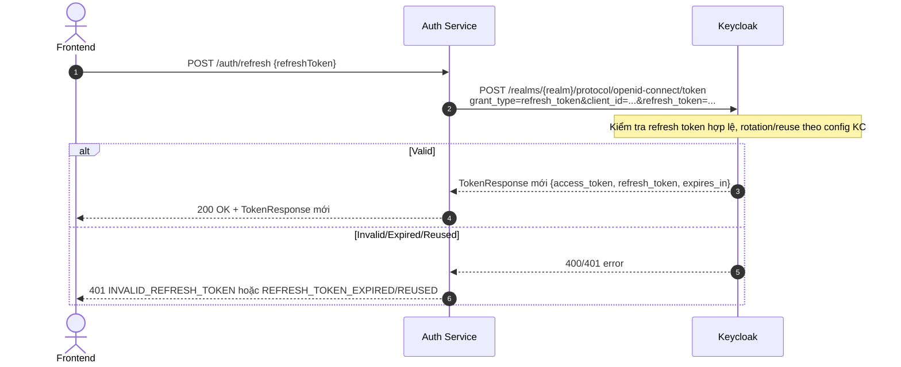

**Key Points:**
- Auth **không lưu refresh token local** — hoàn toàn delegate cho Keycloak
- Rotation/reuse policy do Keycloak config (không phải code Auth)
- Nếu reused → Keycloak revoke toàn bộ token family

---

## 4. Đăng xuất (Logout) — `POST /api/v1/auth/logout`

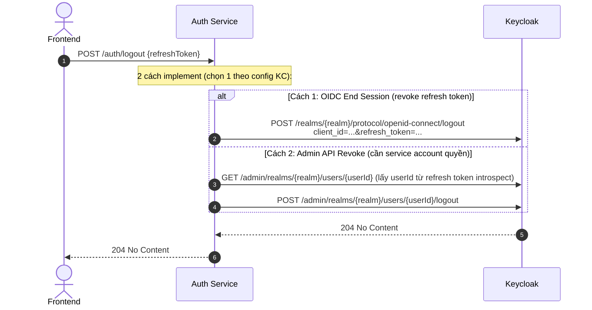

**Key Points:**
- Không chỉ xóa token FE — phải revoke ở Keycloak
- Access token đã cấp vẫn hợp lực đến khi hết hạn (trừ khi config token revocation + resource server check introspection)

---

## 5. Lấy Profile (Me) — `GET /api/v1/auth/me`

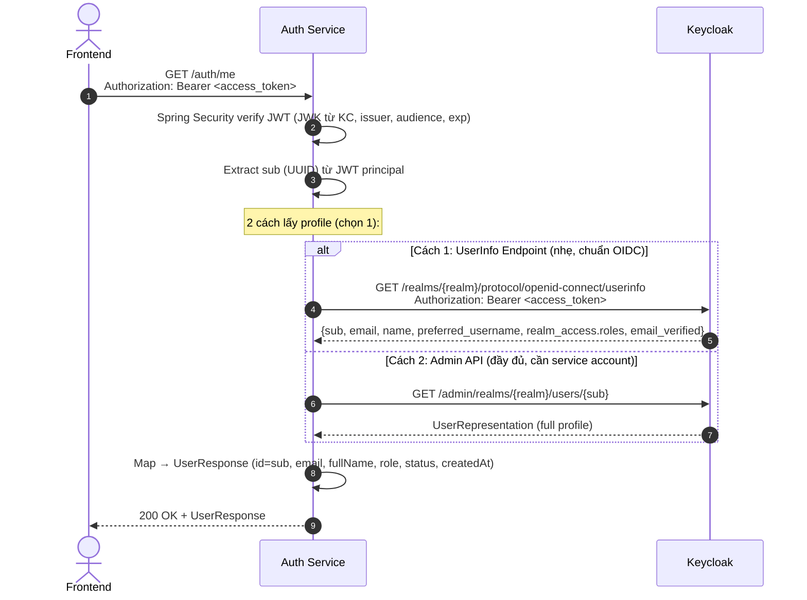

**Key Points:**
- **Không query DB local** — Keycloak là source of truth
- `role` = map từ `realm_access.roles` (chỉ lấy CUSTOMER/ORGANIZER/ADMIN)
- `status` = map từ `enabled` (true=ACTIVE, false=LOCKED)
- `createdAt` = `createdTimestamp` từ Keycloak

---

## 6. Đổi Mật Khẩu (User Self) — `POST /api/v1/auth/change-password`

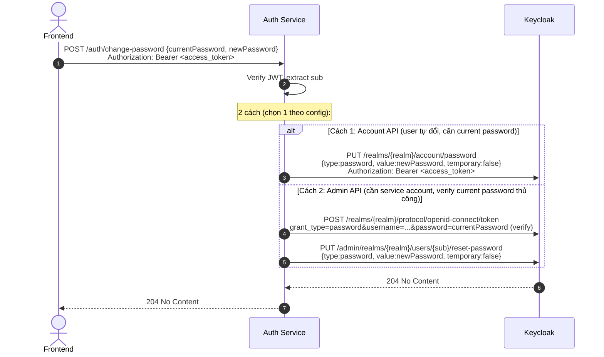

**Key Points:**
- **Không so sánh hash local** — delegate verify cho Keycloak
- Cách 1 (Account API): User tự đổi, cần current password, dùng access token của user
- Cách 2 (Admin API): Cần service account, Auth tự verify current password trước

---

## 7. Quên Mật Khẩu (Forgot Password) — `POST /api/v1/auth/forgot-password`

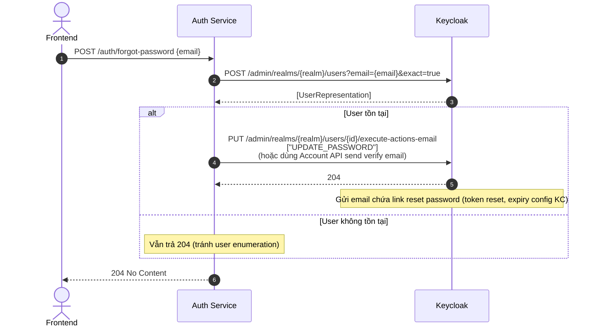

**Key Points:**
- **Luôn trả 204** dù email có tồn tại hay không (security: anti-enumeration)
- Keycloak tự xử lý email template, token reset, expiry
- Link reset redirect về FE `/reset-password?token=...`

---

## 8. Reset Mật Khẩu (User) — `POST /api/v1/auth/reset-password`

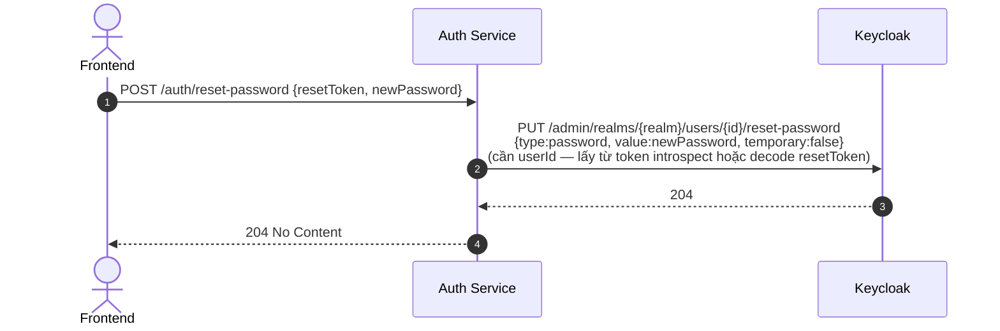

---

## 9. Admin: Danh Sách User — `GET /api/v1/admin/users`

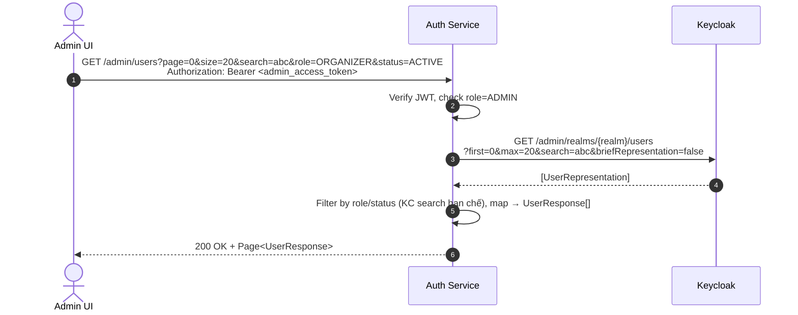

**Key Points:**
- Chỉ ADMIN truy cập (Spring Security `@PreAuthorize("hasRole('ADMIN')")`)
- Keycloak Admin API search giới hạn → Auth Service filter thêm ở memory
- Pagination: `first`/`max` mapping từ `page`/`size`

---

## 10. Admin: Chi Tiết User — `GET /api/v1/admin/users/{userId}`

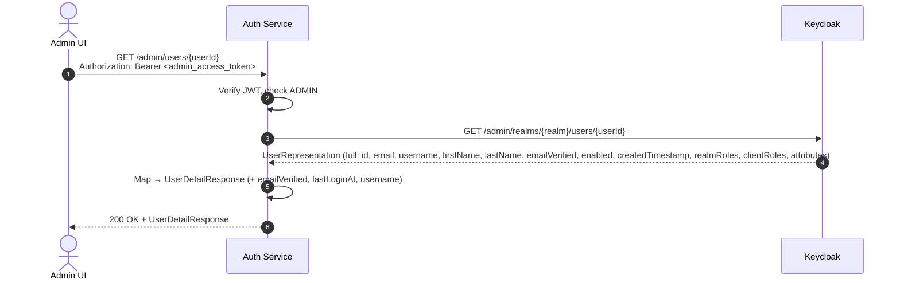

---

## 11. Admin: Khóa/Mở Khóa — `PATCH /admin/users/{userId}/lock|unlock`

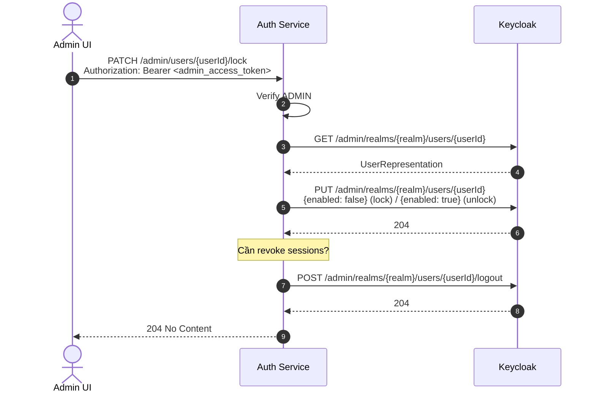

**Key Points:**
- Lock = `enabled=false` + revoke sessions
- Unlock = `enabled=true`
- Idempotent: gọi lại không lỗi

---

## 12. Admin: Gán Role — `PATCH /admin/users/{userId}/role`

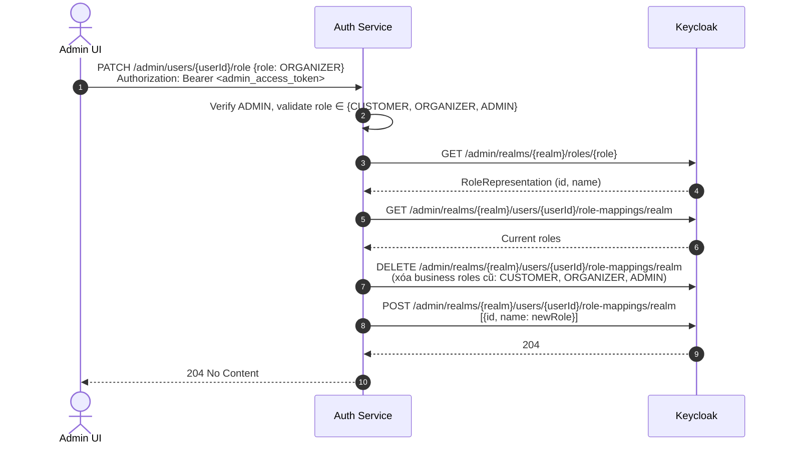

**Key Points:**
- Chỉ map **business roles** (CUSTOMER/ORGANIZER/ADMIN)
- **Không xóa role kỹ thuật** của Keycloak (default-roles, offline_access, uma_authorization...)
- Xóa business roles cũ → thêm role mới (replace)

---

## 13. Admin: Reset Password User Khác — `POST /admin/users/{userId}/reset-password`

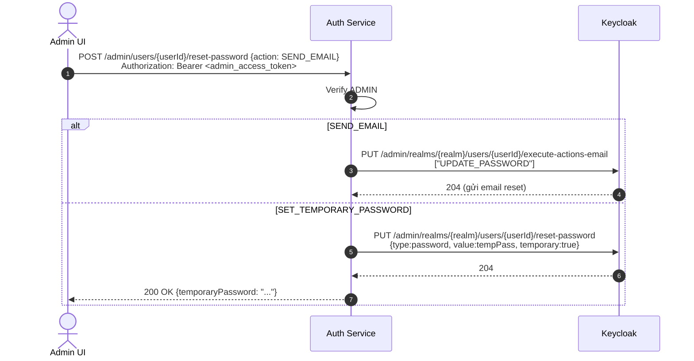

---

## 14. Admin/User: Quản Lý Session

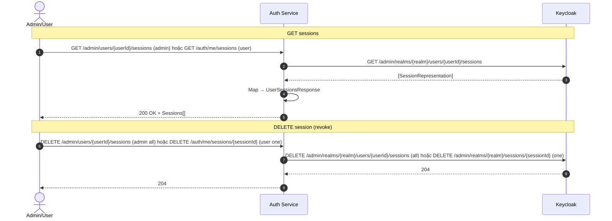

---

## Tổng Hợp: Mapping Endpoint ↔ Keycloak API

| Auth Endpoint | Keycloak Admin API / OIDC Endpoint | Ghi chú |
|---------------|-------------------------------------|---------|
| `POST /auth/register` | `POST /admin/users` + `GET /admin/users/{id}` | Tạo user + gán role CUSTOMER |
| `POST /auth/login` | `POST /protocol/openid-connect/token` (password/code) | Proxy grant flow |
| `POST /auth/refresh` | `POST /protocol/openid-connect/token` (refresh_token) | Delegate rotation cho KC |
| `POST /auth/logout` | `POST /protocol/openid-connect/logout` HOẶC `POST /admin/users/{id}/logout` | Revoke session |
| `GET /auth/me` | `GET /protocol/openid-connect/userinfo` HOẶC `GET /admin/users/{id}` | Lấy profile từ KC |
| `POST /auth/change-password` | `PUT /account/password` HOẶC `PUT /admin/users/{id}/reset-password` | User self-service |
| `POST /auth/forgot-password` | `PUT /admin/users/{id}/execute-actions-email` ["UPDATE_PASSWORD"] | Gửi email reset |
| `POST /auth/reset-password` | `PUT /admin/users/{id}/reset-password` | Đặt pass mới bằng token |
| `POST /auth/verify-email` | `PUT /admin/users/{id}/execute-actions-email` ["VERIFY_EMAIL"] | Xác thực email |
| `POST /auth/resend-verification` | `PUT /admin/users/{id}/execute-actions-email` ["VERIFY_EMAIL"] | Gửi lại email verify |
| `GET /auth/me/sessions` | `GET /admin/users/{id}/sessions` | Session của mình |
| `DELETE /auth/me/sessions/{id}` | `DELETE /admin/sessions/{id}` | Revoke 1 session |
| `GET /admin/users` | `GET /admin/users` (paginated) | List + filter |
| `GET /admin/users/{id}` | `GET /admin/users/{id}` | Chi tiết user |
| `PATCH /admin/users/{id}/lock` | `PUT /admin/users/{id}` {enabled:false} + `POST /admin/users/{id}/logout` | Disable + revoke |
| `PATCH /admin/users/{id}/unlock` | `PUT /admin/users/{id}` {enabled:true} | Enable |
| `PATCH /admin/users/{id}/role` | `DELETE/POST /admin/users/{id}/role-mappings/realm` | Replace business role |
| `POST /admin/users/{id}/reset-password` | `PUT /admin/users/{id}/execute-actions-email` HOẶC `PUT /admin/users/{id}/reset-password` | Admin reset |
| `GET /admin/users/{id}/sessions` | `GET /admin/users/{id}/sessions` | Xem session user |
| `DELETE /admin/users/{id}/sessions` | `DELETE /admin/users/{id}/sessions` | Revoke all sessions |

---

## Cấu Hình Cần Thiết Lập Trên Keycloak (Checklist)

| Cấu hình | Mục đích | Trạng thái |
|----------|----------|------------|
| Realm `eventhub` | Namespace identity | 🔲 Chưa tạo |
| Client `eventhub-auth` (confidential) | Auth Service gọi Admin API | 🔲 Chưa tạo |
| Client `eventhub-frontend` (public) | FE login (Auth Code + PKCE) | 🔲 Chưa tạo |
| Service Account cho `eventhub-auth` | Quyền `manage-users`, `view-users`, `view-realm` | 🔲 Chưa cấp |
| Realm Roles: `CUSTOMER`, `ORGANIZER`, `ADMIN` | Business roles | 🔲 Chưa tạo |
| Protocol Mapper: `business_role` → `realm_access.roles` | Map role vào JWT claim | 🔲 Chưa tạo |
| Protocol Mapper: `sub` → UUID | Đảm bảo sub là UUID | 🔲 Kiểm tra |
| Email template: `verifyEmail`, `resetPassword` | Tùy chỉnh email FE | 🔲 Chưa cấu hình |
| Direct Access Grants: **TẮT** (nếu dùng Auth Code) | Bảo mật | 🔲 Cần tắt |
| Token settings: Access token lifespan, Refresh token reuse | TTL, rotation policy | 🔲 Chưa cấu hình |
| Brute force detection | Bảo vệ login | 🔲 Chưa bật |

---

## Lưu Ý Triển khai Auth Service

1. **Không tự tạo JWT** — chỉ forward token từ Keycloak
2. **Không lưu password/refresh token** — delegate hoàn toàn cho Keycloak
3. **Spring Security Resource Server** verify JWT bằng JWK từ `issuer-uri` (`/.well-known/openid-configuration`)
4. **IdentityMapper** convert JWT → `Actor(UUID userId, BusinessRole role)` cho các service khác
5. **Error mapping**: Keycloak error → EventHub `ErrorResponse` (code, message, timestamp, path)
6. **Timeout**: HTTP client config timeout rõ ràng cho mỗi gọi Keycloak (connect 2s, read 5s)
7. **Retry**: Chỉ retry idempotent (GET), không retry POST/PUT/DELETE
8. **Audit log**: Ghi log admin action (who, what, when) trước khi gọi Keycloak
