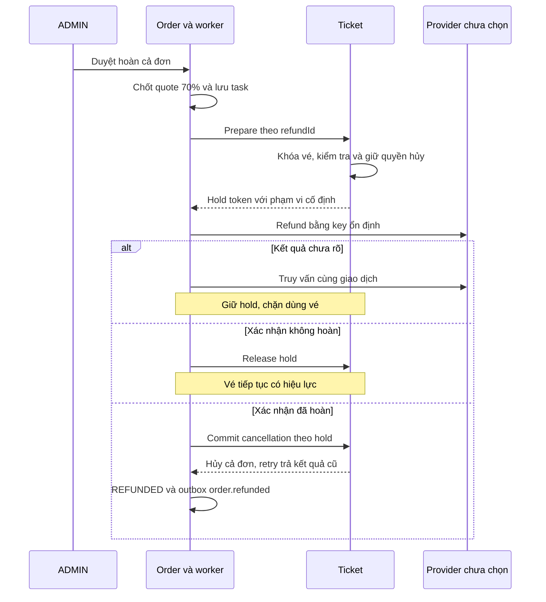

# Điều phối thanh toán, phát vé và hoàn tiền khi có lỗi

Cập nhật 2026-11-05. Chủ dự án giao xử lý C05; đây là phương án Codex chọn. [Quyết định C02–C09](../project-clarifications.md) là nguồn nghiệp vụ, [plan Order](../plans/order-service.md) và [plan Ticket](../plans/ticket-service.md) là nơi triển khai. Tài liệu mô tả thiết kế cần xây, chưa phải worker/API/migration đã chạy.

## 1. Hai loại hoàn tiền

| Trường hợp | Tiền và điều kiện | Kết quả |
|---|---|---|
| Khách hủy đơn đã phát vé | 70% giá đã mua, cả đơn, mọi vé chưa dùng, còn ít nhất 48 giờ lúc yêu cầu và duyệt; ADMIN duyệt. Giữ lại 30%, không thêm phí khác. | Hủy tất cả vé, trả tiền theo quote và phát order.refunded. |
| Hệ thống thu tiền nhưng không cung cấp được vé hoặc thu trùng | Hoàn bù 100% khoản thực thu của giao dịch cần bù còn chưa hoàn; không áp phần giữ lại 30% hoặc điều kiện 48 giờ. | Kết thúc/đối soát luồng phát vé hay giao dịch dư; không tính hoàn doanh thu vào Analytics nếu chưa có sale tương ứng. |

Mỗi lệnh tiền gắn provider transaction và idempotency key cố định. Ledger/khóa phải bảo đảm tiền đã hoàn cộng các yêu cầu đang giữ quyền hoàn không vượt số thực thu, kể cả refund và compensation đua nhau. Hoàn về giao dịch gốc theo provider, không chuyển tiền tới địa chỉ email.

## 2. Trạng thái công việc bền vững

Giữ enum nghiệp vụ Order/Payment/Refund hiện hành; bổ sung operation/task để biết bước đang chờ. PAID riêng lẻ không thể hiện vé đã phát, tiền hoàn đã chuyển hay việc đối soát đã xong.

| Bước dự kiến | Ý nghĩa |
|---|---|
| WAIT_CONFIRM | Đã thu tiền, cần Ticket xác nhận/phát vé. |
| PREPARE_REFUND | Cần Ticket giữ quyền hủy toàn bộ vé. |
| WAIT_PROVIDER | Đã giữ quyền hủy, chuẩn bị/gửi hoàn tiền theo key cố định. |
| VERIFY_PROVIDER | Kết quả tiền UNKNOWN; xác minh cùng giao dịch, không tạo key mới. |
| WAIT_CANCEL | Provider đã hoàn, cần commit hủy theo hold. |
| WAIT_RELEASE_HOLD | Provider xác nhận dứt khoát không hoàn, cần mở lại quyền dùng vé. |
| WAIT_COMPENSATION | Đã fence phát vé hoặc xác định khoản thu dư, cần hoàn bù toàn phần. |
| MANUAL_REVIEW | Có mâu thuẫn/lỗi không tự xử lý được, ADMIN đối soát với bằng chứng và audit; không tự coi là xong. |
| COMPLETED | Đã xác nhận và lưu đủ mọi hiệu ứng bắt buộc. |

Task cần id, operation_id, aggregate_id, kind, fingerprint/payload cố định, attempts, next_attempt_at, lease_token, lease_until, last_error. UNIQUE theo operation_id + kind, không chỉ orderId + kind: một đơn có thể có nhiều giao dịch provider cần xử lý riêng. Worker claim trong transaction ngắn, gọi HTTP ngoài transaction, hoàn tất bằng lease token/CAS. Lease worker hết hạn không tự giải phóng quyền hủy vé.

Ghi kết quả local và task tiếp theo cùng transaction trước ACK webhook. Retry có backoff và lịch trong DB để worker mới tiếp tục sau restart. Công việc treo có cảnh báo theo ngưỡng cấu hình; MANUAL_REVIEW vẫn giữ receipt/task/hold, không xóa bằng chứng hoặc mở vé khi kết quả tiền còn UNKNOWN.

## 3. Luồng hoàn 70% khi khách hủy

1. CUSTOMER gửi reason cho đơn mình; Order kiểm tra PAID, mọi vé chưa dùng, >=48 giờ và không có refund/compensation đang giữ quyền trên cùng tiền. Request chưa gọi provider.
2. ADMIN duyệt thì kiểm tra lại điều kiện, lưu quote/phân bổ và task. Không giữ transaction DB Order lúc chờ HTTP.
3. Ticket prepare khóa toàn bộ vé theo thứ tự ticketId ổn định: tất cả thuộc đơn, scope đủ cả đơn, ISSUED, không có hold khác, còn >=48 giờ theo Event đã xác minh. Một vé không hợp lệ thì rollback hết.
4. Ticket lưu hold với refundId, orderId, tập ticketIds/fingerprint, token, mốc chốt điều kiện và trạng thái PREPARED. Mọi đường scan/cancel/đổi hiệu lực phải kiểm tra hold dưới cùng khóa/CAS; scan không thể vượt hold đã thắng. Không giữ khóa DB trong suốt thời gian provider chạy.
5. Có hold rồi Order mới gửi refund; intent và provider key được lưu trước lời gọi. Timeout/mất response là UNKNOWN: query theo key/receipt, không thử lại bằng key khác.
6. Provider success: ghi provider refund ID, amount, refundedAt cùng task CANCEL. Ticket commit PREPARED → COMMITTED, hủy toàn bộ vé và hoàn quota đúng một lần. Không từ chối vì đồng hồ đã đi qua mốc 48 giờ sau prepare. Response mất thì retry cùng token trả kết quả COMMITTED đã lưu.
7. Order chỉ ghi Refund/Order REFUNDED và outbox order.refunded sau provider success lẫn Ticket COMMITTED. Nếu đang WAIT_CANCEL, số tiền/refundedAt đã xác nhận vẫn được lưu; không giả rằng tiền chưa hoàn.
8. Provider xác nhận chắc chắn không hoàn và lệnh không thể thành công muộn: enqueue RELEASE_HOLD. Sau release, vé dùng lại bình thường, Order vẫn PAID, refund FAILED. Timeout/5xx chưa đủ bằng chứng để release.

Hold không tự hết hạn khi tiền UNKNOWN/đã hoàn. Job đối soát xác minh rồi mới commit/release. Nếu đã hoàn mà commit lỗi do code/dữ liệu: giữ hold, MANUAL_REVIEW, sửa rồi commit có audit; không tự mở vé, thu tiền lại hoặc phát refund event sớm. Đây là điều kiện phải kiểm chứng trước khi bật refund.

## 4. Thu tiền nhưng không phát được vé

| Tình huống | Hướng xử lý đã chọn |
|---|---|
| Confirm timeout, chưa biết đã tạo vé chưa | Retry cùng reservationId/payload hoặc query kết quả. Đã CONFIRMED thì lấy vé cũ và hoàn tất order.paid, không vừa phát vé vừa hoàn bù. |
| Reservation EXPIRED/RELEASED, chưa phát vé | Lưu quyết định không phát, enqueue bù 100% thực thu chưa hoàn. Không hồi sinh giữ chỗ, lấy quota của khách khác hoặc bỏ kiểm tra tồn kho. |
| Confirm lỗi vĩnh viễn nhưng request confirm khác có thể đang bay | Ticket fence/abort nguyên tử trước bù. Confirm đã thắng thì trả vé cũ; abort thắng thì confirm muộn bị chặn. Chỉ nhánh chưa phát và đã fence được bù. |
| Success webhook tới sau Order EXPIRED/FAILED | Lưu Payment SUCCEEDED và bằng chứng tiền; không tự hồi đơn thành PAID/phát vé. Xác minh Ticket/fence rồi bù 100%, theo dõi bằng operation riêng. |
| Payment hợp lệ đã có vé, payment thứ hai bị thu | Giữ vé hợp lệ, bù giao dịch dư theo transaction riêng; không confirm lại hoặc cộng thêm order.paid. |
| Refund bù timeout | VERIFY_PROVIDER cùng key, giữ task/bằng chứng; ADMIN đối soát nếu chưa giải được, không báo đã hoàn khi chưa có kết quả. |

Query “chưa thấy vé” không đủ chống confirm tới muộn. Fence phải có transaction/khóa reservation và kết quả truy vấn/retry được tại Ticket; một cờ trong RAM Order không đủ. Reservation đã EXPIRED/RELEASED phải chặn mọi confirm về sau.

Đơn chưa phát vé/chưa phát order.paid không đưa order.refunded vào Analytics: sẽ ghi hoàn doanh thu chưa từng được tính bán. Chọn message riêng payment.compensated cho Notification khi triển khai; đây là topic/consumer dự kiến, chưa có trong runtime.

## 5. Tính và lưu tiền hoàn

Basis là tổng line_total của cả đơn đã snapshot, khớp số thực thu trong phạm vi không phí/voucher. Quote lưu một lần với policy version CUSTOMER_CANCEL_70_V1. Amount dùng BigDecimal × 0.70, scale 2, HALF_UP. Đơn 1.300.000 đồng hoàn 910.000, giữ 390.000.

Mỗi hạng lấy phần nguyên theo đơn vị 0,01 của 70% line_total. Chênh tới tổng amount được phân theo phần dư lớn nhất, hòa theo ticketTypeId tăng dần. Lưu phân bổ và kiểm tra tổng bằng amount. items[].quantity phải bằng toàn bộ số vé của hạng, không nhân quantity với 70%.

Không cần refund_items cho lựa chọn từng vé vì giai đoạn này không hỗ trợ; vẫn cần storage allocation theo hạng để retry dùng cùng quote. Bù kỹ thuật dùng policy FULFILLMENT_COMPENSATION_100_V1, bám thực thu từng transaction và tiền đã hoàn, không áp 70%.

Đơn miễn phí/quote 0 không gọi refund chuyển tiền dương; hủy đơn miễn phí là luồng riêng cần định nghĩa. Provider C06 phải kiểm tra đơn vị tiền và khả năng query/idempotency; không giả mọi provider có cùng API hoặc âm thầm làm tròn lại quote.

## 6. API và storage cần bổ sung

Các tên dưới là thiết kế dự kiến; cần migration/DTO/lỗi/OpenAPI trước client/server. /internal/** chỉ S2S, không route public.

| Bổ sung | Trách nhiệm |
|---|---|
| orders.customer_email và nguồn snapshot | Email người mua đã xác minh, không đổi theo hồ sơ sau đặt. |
| Payment/fulfillment operation + pending_operations | Bước đang chờ, provider transaction/refund ID, key, tiền, UNKNOWN/SUCCEEDED/FAILED, lịch retry và quyết định đối soát. |
| Refund quote/allocation | Base/rate/amount/phần giữ lại/policy version và phân bổ hạng; không tính lại từ giá hiện tại. |
| Ticket refund_holds và tập vé | PREPARED/COMMITTED/RELEASED; ràng buộc chống hai hold còn hiệu lực trên cùng vé. |
| POST /internal/orders/{orderId}/refund-holds tại Ticket | Prepare theo refundId, scope/48h/vé; trả token. Query bằng refundId để xác minh timeout. |
| POST /internal/refund-holds/{token}/commit hoặc /release | Hủy hoặc trả quyền dùng, idempotent; quyết định xung đột trả 409 và đối soát. |
| Query confirm + abort/fence reservation | Phân biệt đã phát với chưa phát nhưng có request đang bay; abort không được đảo kết quả CONFIRMED đã thắng. |
| Chặn scan/cancel khi có hold | Mọi đường ghi trạng thái vé cùng tuân thủ, không chỉ một controller. |

Không thêm tên trạng thái trong tài liệu rồi coi schema đã hỗ trợ. Order REFUNDED mô tả kết quả hoàn khách; lỗi phát vé và bù payment theo dõi riêng. Cần audit ai duyệt/đối soát, bằng chứng provider, key đã dùng và quyết định cuối.

## 7. Thông báo và Analytics

| Message | Khi phát | Consumer |
|---|---|---|
| order.paid | Thu tiền và Ticket phát vé xong | Analytics cộng gộp theo paidAt. |
| order.refunded | Provider xác nhận hoàn, Ticket commit hủy xong | Notification gửi buyer; Analytics ghi thực hoàn 70% theo refundedAt, quantity cả đơn. |
| payment.compensated, dự kiến | Provider xác nhận đã bù giao dịch | Notification, key orderId; không đi vào nhánh sales/refund Analytics. |

Message bù dự kiến dùng envelope chuẩn cùng orderId, paymentId, compensationId, customerId, customerEmail snapshot, currency, amount thực hoàn, compensatedAt, reason (RESERVATION_EXPIRED/FULFILLMENT_FAILED/DUPLICATE_CAPTURE). Không QR, không cộng/trừ sales. Topic, producer outbox, consumer và template tương ứng chưa có; triển khai cùng nhánh compensation sau C06.

## 8. Checklist chạy thử trước khi bật

Theo quy ước repo, đây là checklist thủ công, không tạo file/dependency test:

- Webhook lặp/crash sau ACK: một quyết định confirm/refund và outbox đúng ID.
- Confirm timeout nhưng đã phát vé: lấy lại vé cũ, không bù; abort đua confirm chỉ một nhánh thắng.
- Expiry đua success: giữ bằng chứng thực thu, không oversell, bù 100% đúng một lần nếu không cung cấp vé.
- Hai refund hoặc refund đua scan: một quyền thắng; scan không qua hold đã chuẩn bị.
- Refund timeout/response mất: verify cùng key, không gửi tiền hai lần hoặc release khi UNKNOWN.
- Qua mốc 48 giờ giữa prepare/commit: quyền đã giữ vẫn commit được.
- Commit response mất: retry không trả quota hai lần; Order phát một order.refunded.
- Provider xác nhận không hoàn: release có retry, vé tiếp tục dùng; không phát refund sale.
- Tổng allocation bằng amount, hủy cả quantity; compensation không làm âm báo cáo sales.
- Công việc treo/receipt mâu thuẫn/khác số tiền xuất hiện cho ADMIN đối soát, giữ audit và không tự COMPLETED.
