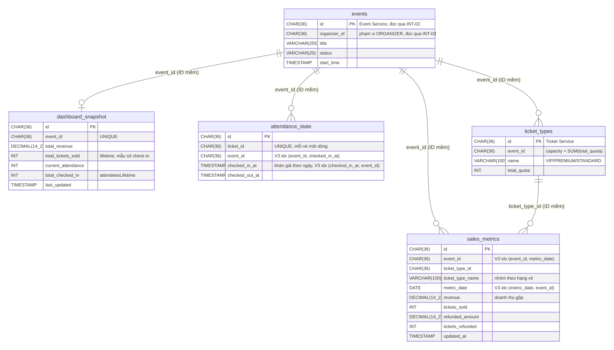
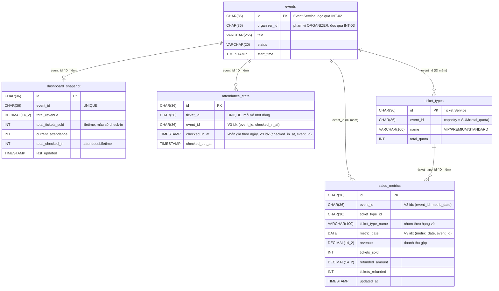

# ERD thống kê gộp cho ADMIN và ORGANIZER (C10)

Đề xuất 2026-11-13; analytics-service đã triển khai và có migration V3 ngày 2026-11-14 (Event INT-02, INT-03 và Ticket capacity chưa có). Sơ đồ này bổ sung cho [ERD Analytics](erd.md) (sinh tự động từ [init.sql](init.sql)) để phục vụ thiết kế và báo cáo: C10 **không thêm bảng hay cột** vào Analytics, chỉ thêm index V3 và đọc metadata từ Event/Ticket qua API nội bộ. `init.sql` đã gồm 4 index V3 và `erd.svg` đã được sinh lại, nhưng ERD tự động không vẽ index nên hình không đổi; sơ đồ dưới đây là nơi thể hiện index và quan hệ C10.

Nét liền là bảng thuộc `eventhub_analytics`. `events` (Event Service) và `ticket_types` (Ticket Service) là bảng của service khác, chỉ hiện các cột C10 dùng; quan hệ là **ID mềm** (không có FK, không JOIN xuyên database). Analytics lấy dữ liệu của hai bảng này qua `GET /internal/events?ids=` (INT-02), `GET /internal/events/ids?organizerId=` (INT-03: danh sách sự kiện của ORGANIZER, dùng làm điều kiện `event_id IN (...)`) và `GET /internal/ticket-types/capacity?eventIds=`.

`attendance_logs` và `processed_events` không tham gia C10 nên không vẽ ở đây.

## Bảng nào phục vụ số liệu nào

| Số liệu trên trang Phân tích | Bảng / nguồn | API |
|---|---|---|
| Doanh thu gộp, hoàn, thuần; vé bán, vé hoàn theo ngày/tháng | `sales_metrics` (`metric_date`) | `/analytics/overview` |
| Khán giả tham gia theo ngày/tháng | `attendance_state.checked_in_at` | `/analytics/overview` |
| Phân bổ theo hạng vé | `sales_metrics.ticket_type_name` | `/analytics/overview` |
| Xếp hạng sự kiện theo doanh thu/vé/khán giả | `sales_metrics` + `attendance_state` nhóm theo `event_id` | `/analytics/events` |
| Tỉ lệ check-in (toàn thời gian) | `dashboard_snapshot.total_tickets_sold`, `total_checked_in` − `SUM(sales_metrics.tickets_refunded)` | `/analytics/events` |
| Tên, trạng thái, ngày diễn ra | `events` (Event Service) | INT-02 `GET /internal/events?ids=` |
| Sức chứa | `ticket_types.total_quota` (Ticket Service) | `GET /internal/ticket-types/capacity` |
| Phạm vi của ORGANIZER (chỉ sự kiện của mình) | `events.organizer_id` (Event Service) | INT-03 `GET /internal/events/ids?organizerId=` |

## Index đề xuất V3

| Index | Bảng | Truy vấn dùng |
|---|---|---|
| `idx_sales_date_event (metric_date, event_id)` | sales_metrics | Lọc khoảng ngày trên toàn hệ thống |
| `idx_sales_event_date (event_id, metric_date)` | sales_metrics | Lọc khoảng ngày của một sự kiện |
| `idx_state_checkin_event (checked_in_at, event_id)` | attendance_state | Đếm khán giả theo khoảng thời gian |
| `idx_state_event_checkin (event_id, checked_in_at)` | attendance_state | Đếm khán giả của một sự kiện |

Nguồn thiết kế: [plan Analytics §8](../../plans/analytics-service.md), quyết định [C10](../../project-clarifications.md), từ điển trường [§7](fields.md). Tạo lại ảnh: dán khối Mermaid trên vào công cụ render Mermaid và xuất SVG ra `erd-c10.svg`.
