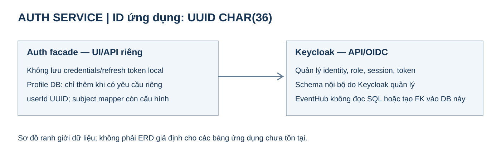

# Ranh giới dữ liệu Auth

Auth giữ UI/API riêng và gọi Keycloak theo xác nhận chủ dự án. Chưa có schema local được duyệt nên không vẽ các bảng users/password_hash/refresh_tokens như thể cần tạo chúng. UUID CHAR(36) áp dụng cho PK/tham chiếu ứng dụng EventHub, không sửa schema nội bộ Keycloak. [Chi tiết](README.md), [plan Auth](../../plans/auth-service.md).
