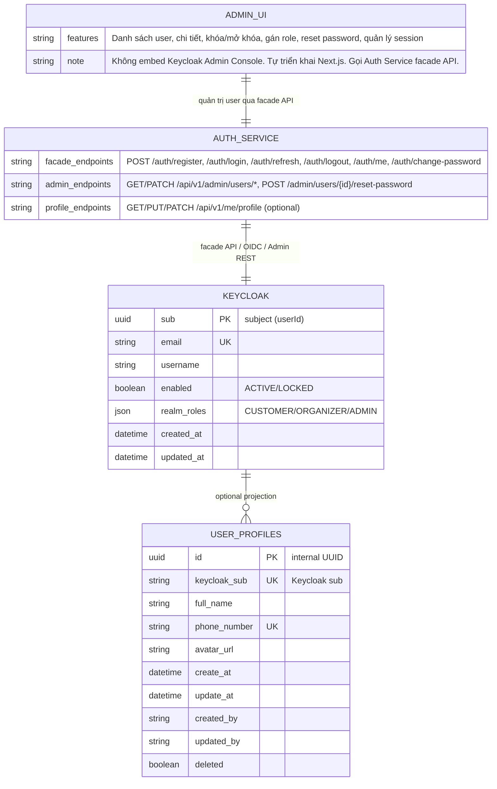

# Ranh giới dữ liệu Auth

> **Lưu ý**: Bảng `user_profiles` là optional projection, đã implement sẵn. Keycloak schema nội bộ không vẽ chi tiết (do Keycloak tự quản lý). Admin UI là frontend riêng, không dùng Keycloak WebUI.