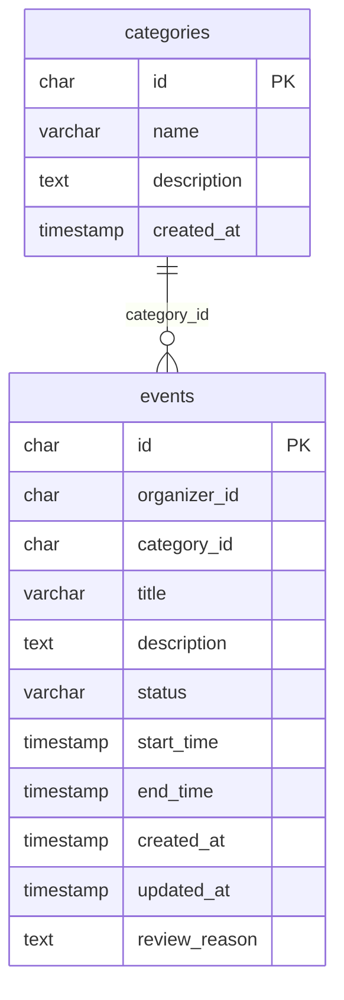

# ERD event-service — BC_32_V2 đã đối chiếu

Nguồn vật lý: [init.sql](init.sql). Đây là schema tham chiếu mục tiêu, chưa có migration nghiệp vụ trong module. [Quyết định nguồn](../../architecture/source-decisions.md) và [điểm cần chốt](../../project-clarifications.md).

Chỉ các đường nối trên là FK nội bộ. ID tham chiếu service khác chỉ là UUID mềm; không truy cập DB khác. Ảnh JPEG cũ trong thư mục là lịch sử, không phải ERD hiện hành. Cột outbox (nếu có) là bổ sung kỹ thuật chống mất message sau commit. Xem mapping/giới hạn ở [database README](../README.md).
