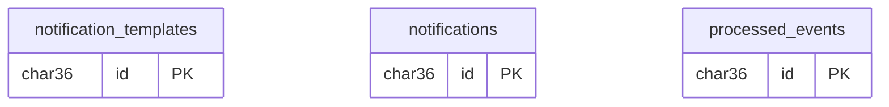

# ERD notification-service

Schema nền theo [migration V1](../../../notification-service/src/main/resources/db/migration/V1__init.sql); bản đọc tại [init.sql](init.sql). Các bảng: `notification_templates`, `notifications`, `processed_events`. Không FK vật lý xuyên service.

Đây là ERD mức bảng, không phải toàn bộ cột; xem DDL để biết unique/index. Các bảng chỉ liên hệ theo khóa nghiệp vụ/UUID mềm, không thêm FK vào các DB nguồn. [Giới hạn schema và mapping V2](../README.md).
