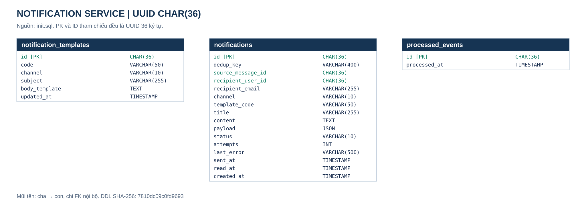
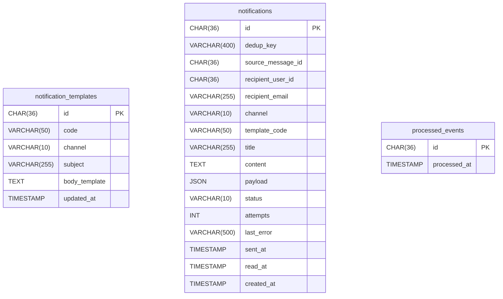

# ERD notification-service

Nguồn: [init.sql](init.sql), schema tham chiếu hiện hành; không tự triển khai thêm migration/field đang được đề xuất. Migration nền: [V1](../../../notification-service/src/main/resources/db/migration/V1__init.sql).

Ảnh SVG và Mermaid được tạo từ cùng DDL, gồm đầy đủ cột. Mọi PK/tham chiếu bảng EventHub dùng UUID CHAR(36); không FK/JOIN xuyên service.

Tạo lại bằng [render-erd.mjs](../render-erd.mjs); kiểm tra lệch nguồn với node docs/database/render-erd.mjs --check từ root. JPEG Order/Ticket tạo lại bằng [render-erd.ps1](../render-erd.ps1). Không đọc ảnh cũ để suy ra kiểu ID. Các bảng/cột kỹ thuật còn đề xuất trong [plans](../../plans/README.md) chỉ được thêm vào ERD sau khi có DDL/migration tương ứng. [Mapping và giới hạn](../README.md).
