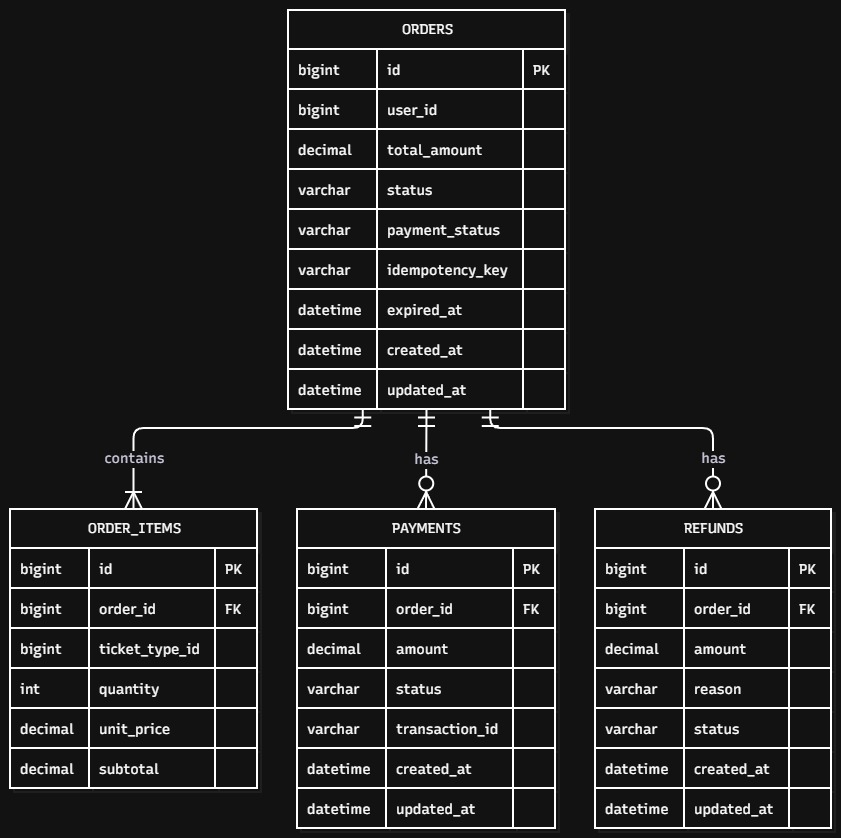

erDiagram
    ORDERS ||--|{ ORDER_ITEMS : contains
    ORDERS ||--o{ PAYMENTS : has
    ORDERS ||--o{ REFUNDS : has

    ORDERS {
        bigint id PK
        bigint user_id
        decimal total_amount
        varchar status
        varchar payment_status
        varchar idempotency_key
        datetime expired_at
        datetime created_at
        datetime updated_at
    }

    ORDER_ITEMS {
        bigint id PK
        bigint order_id FK
        bigint ticket_type_id
        int quantity
        decimal unit_price
        decimal subtotal
    }

    PAYMENTS {
        bigint id PK
        bigint order_id FK
        decimal amount
        varchar status
        varchar transaction_id
        datetime created_at
        datetime updated_at
    }

    REFUNDS {
        bigint id PK
        bigint order_id FK
        decimal amount
        varchar reason
        varchar status
        datetime created_at
        datetime updated_at
    }

