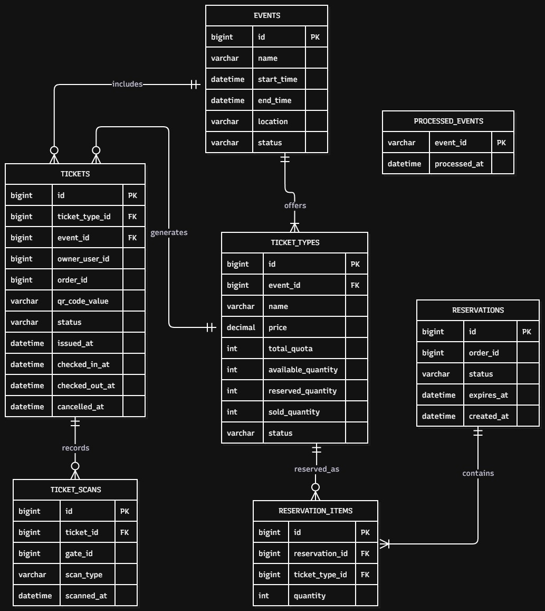

erDiagram
    EVENTS ||--|{ TICKET_TYPES : offers
    TICKET_TYPES ||--o{ RESERVATION_ITEMS : reserved_as
    RESERVATIONS ||--|{ RESERVATION_ITEMS : contains
    TICKET_TYPES ||--o{ TICKETS : generates
    EVENTS ||--o{ TICKETS : includes
    TICKETS ||--o{ TICKET_SCANS : records

    EVENTS {
        bigint id PK
        varchar name
        datetime start_time
        datetime end_time
        varchar location
        varchar status
    }

    TICKET_TYPES {
        bigint id PK
        bigint event_id FK
        varchar name
        decimal price
        int total_quota
        int available_quantity
        int reserved_quantity
        int sold_quantity
        varchar status
    }

    RESERVATIONS {
        bigint id PK
        bigint order_id
        varchar status
        datetime expires_at
        datetime created_at
    }

    RESERVATION_ITEMS {
        bigint id PK
        bigint reservation_id FK
        bigint ticket_type_id FK
        int quantity
    }

    TICKETS {
        bigint id PK
        bigint ticket_type_id FK
        bigint event_id FK
        bigint owner_user_id
        bigint order_id
        varchar qr_code_value
        varchar status
        datetime issued_at
        datetime checked_in_at
        datetime checked_out_at
        datetime cancelled_at
    }

    TICKET_SCANS {
        bigint id PK
        bigint ticket_id FK
        bigint gate_id
        varchar scan_type
        datetime scanned_at
    }

    PROCESSED_EVENTS {
        varchar event_id PK
        datetime processed_at
    }

