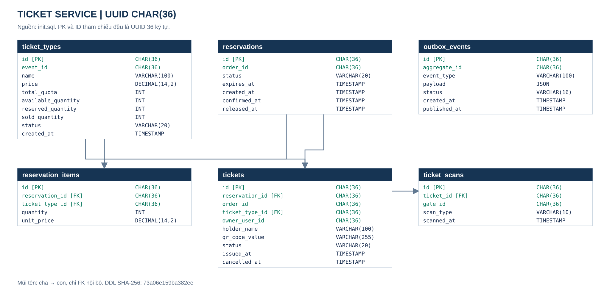
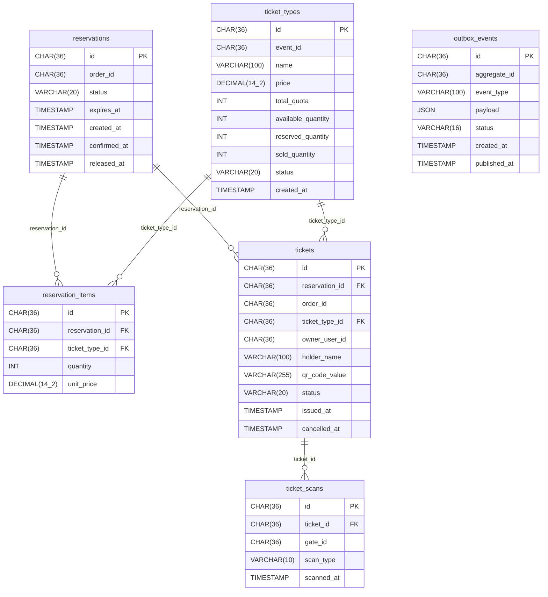

# ERD ticket-service

Nguồn: [init.sql](init.sql), schema tham chiếu hiện hành; không tự triển khai thêm migration/field đang được đề xuất.

Ảnh SVG và Mermaid được tạo từ cùng DDL, gồm đầy đủ cột. Mọi PK/tham chiếu bảng EventHub dùng UUID CHAR(36); không FK/JOIN xuyên service. [JPEG tương thích](1.jpeg).

<<<<<<< HEAD
Chỉ các đường nối trên là FK nội bộ. ID tham chiếu service khác chỉ là UUID mềm; không truy cập DB khác. [Ảnh ERD](1.jpeg) đã được tạo lại từ DDL hiện hành với UUID `CHAR(36)`; chạy [script](../render-erd.ps1) để cập nhật khi DDL đổi. Cột outbox là bổ sung kỹ thuật chống mất message sau commit. Xem mapping/giới hạn ở [database README](../README.md).
=======
Tạo lại bằng [render-erd.mjs](../render-erd.mjs); kiểm tra lệch nguồn với node docs/database/render-erd.mjs --check từ root. JPEG Order/Ticket tạo lại bằng [render-erd.ps1](../render-erd.ps1). Không đọc ảnh cũ để suy ra kiểu ID. Các bảng/cột kỹ thuật còn đề xuất trong [plans](../../plans/README.md) chỉ được thêm vào ERD sau khi có DDL/migration tương ứng. [Mapping và giới hạn](../README.md).
>>>>>>> 2d5e52cfa09fc1574dc9cd7ae930bf9373836f62
