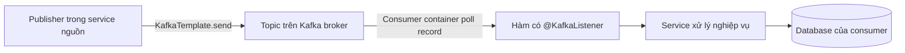
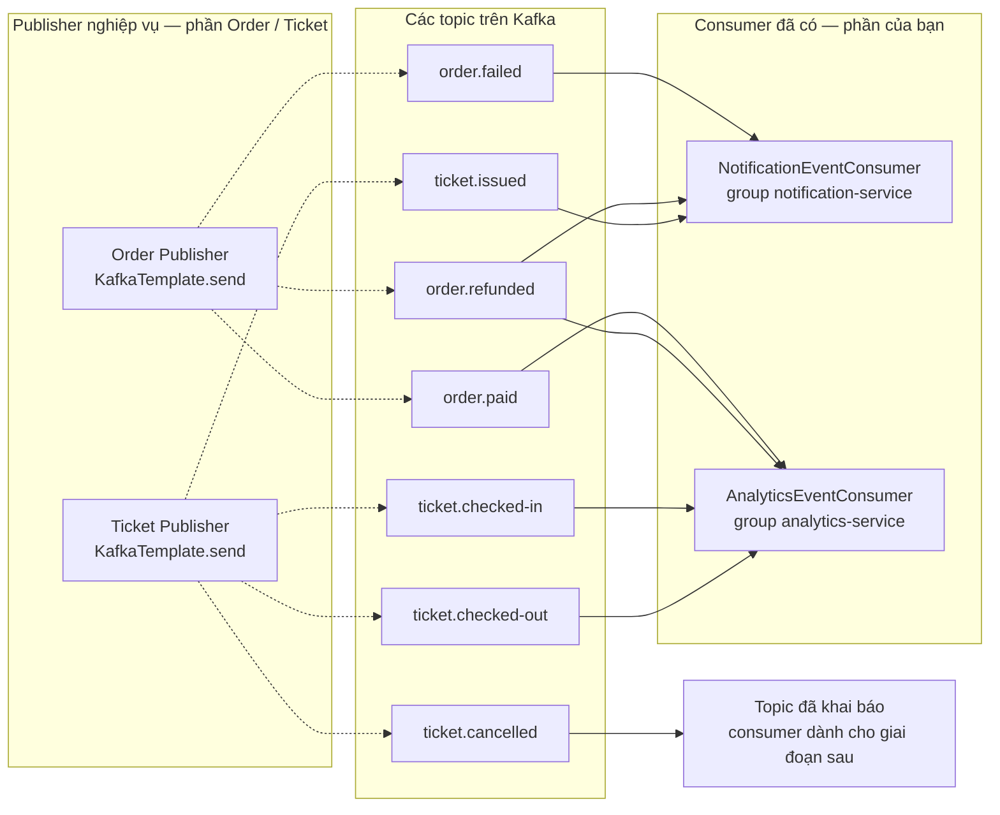
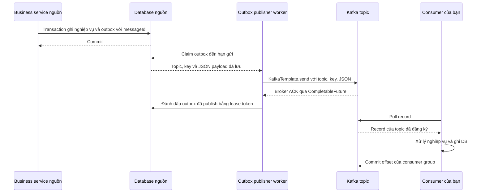
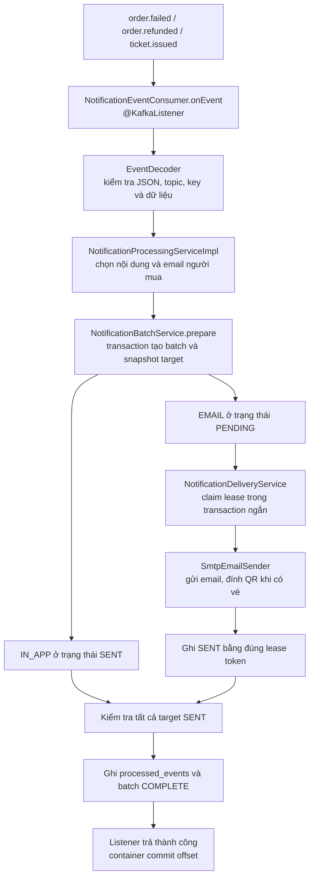
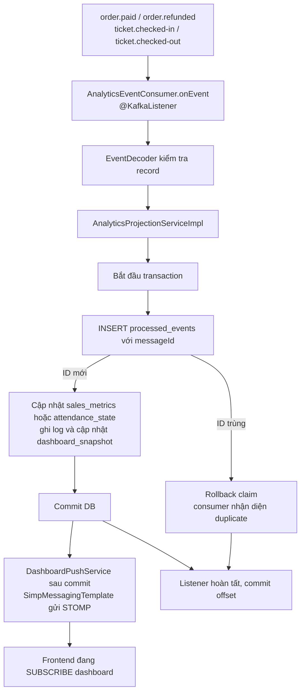
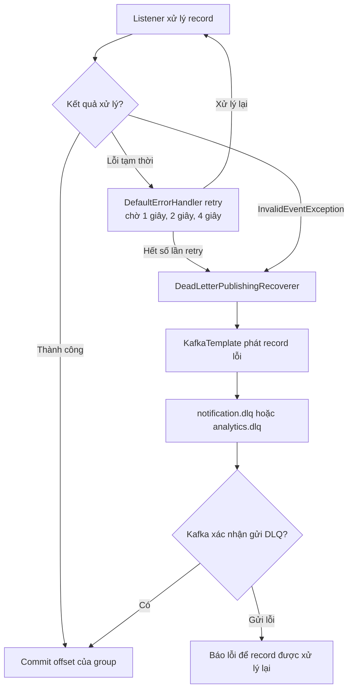

# Luồng publisher, topic và consumer của EventHub

Đọc code theo thứ tự file và hàm ở [hướng dẫn Notification/Analytics](../notification-analytics-code-reading.md).

Cập nhật 2026-11-05, đối chiếu code Notification/Analytics và [hợp đồng Kafka](events.md). Sơ đồ tổng quan thể hiện các publisher nghiệp vụ cần triển khai ở Order/Ticket và các consumer đã có trong hai service của bạn.

## 1. Một message đi qua những gì?



| Thành phần | Ví dụ trong dự án |
|---|---|
| Publisher / producer | Order thông báo một đơn đã thanh toán, Ticket thông báo đã phát vé |
| Topic | Tên luồng lưu các message cùng loại, ví dụ `order.paid` |
| Message / record | Một sự kiện cụ thể, có JSON payload, key, partition và offset |
| Consumer | Notification đọc sự kiện để gửi email, Analytics đọc để cập nhật thống kê |
| `KafkaTemplate` | API Spring dùng để gửi record tới topic |
| `@KafkaListener` | Đánh dấu hàm mà Spring gọi khi consumer container nhận record |

Consumer container của Spring thực hiện poll Kafka rồi gọi hàm listener. Record được lưu trên Kafka theo cấu hình retention, mỗi consumer group lưu vị trí đọc của mình bằng offset. [Spring về KafkaListener](https://docs.spring.io/spring-kafka/reference/3.3/kafka/receiving-messages/listener-annotation.html), [Kafka về các khái niệm](https://kafka.apache.org/41/getting-started/introduction/).

## 2. Bản đồ topic của toàn bộ EventHub



Đường nét đứt là publisher nghiệp vụ cần nhóm Order/Ticket nối vào. Khi đối chiếu ngày 2026-11-05, các lệnh phát Kafka nghiệp vụ ở hai module đó còn cần triển khai. Đường liền vào Notification/Analytics tương ứng các listener đã có code.

| Topic | Publisher | Consumer | Việc consumer thực hiện |
|---|---|---|---|
| `order.paid` | Order | Analytics | Cộng doanh thu và số vé bán |
| `order.failed` | Order | Notification | Tạo IN_APP và email đơn thất bại/hết hạn |
| `order.refunded` | Order | Notification + Analytics | Thông báo hoàn tiền, ghi tiền/vé hoàn vào báo cáo |
| `ticket.issued` | Ticket | Notification | Gửi email người mua kèm QR và tạo IN_APP |
| `ticket.checked-in` | Ticket | Analytics | Ghi bằng chứng vào cổng, cập nhật attendance |
| `ticket.checked-out` | Ticket | Analytics | Ghi bằng chứng ra cổng, cập nhật attendance |
| `ticket.cancelled` | Ticket | Consumer giai đoạn sau | Topic đã khai báo trong script hạ tầng |
| `notification.dlq` | Error handler của Notification | Vận hành / replay | Lưu record Notification xử lý thất bại |
| `analytics.dlq` | Error handler của Analytics | Vận hành / replay | Lưu record Analytics xử lý thất bại |

Ví dụ một message `order.refunded` được cả Notification và Analytics đọc vì chúng dùng hai group khác nhau. Mỗi group có offset và tiến độ riêng. Notification có thể gửi email xong trong khi Analytics đang retry cập nhật DB.

Trong cùng một group, mỗi partition được giao cho một consumer tại một thời điểm. Cấu hình hiện tại có ba partition/topic và concurrency 3. Key của các sự kiện đơn hàng là `orderId`, key check-in/out là `ticketId`. Thứ tự được giữ trong từng partition của từng topic, hai topic check-in/out vẫn có thể đến đảo thứ tự. [Kafka về topic và partition](https://kafka.apache.org/41/getting-started/introduction/).

## 3. Publisher dùng KafkaTemplate ra sao?

Theo thiết kế outbox của EventHub, service nguồn lưu thay đổi nghiệp vụ và bản ghi outbox trong cùng transaction. Worker publisher đọc outbox đã commit, gọi `KafkaTemplate.send`, rồi cập nhật trạng thái publish sau khi Kafka ACK.



Ví dụ minh họa bên trong worker outbox của Order, khi `payloadJson` là JSON của `OrderPaidEvent` đã lưu trong outbox.

```java
// topic là loại sự kiện, key chọn partition, value là JSON payload.
var pending = kafkaTemplate.send("order.paid", orderId.toString(), payloadJson);

// Worker chỉ ghi trạng thái published sau khi broker xác nhận.
var acknowledged = pending.get(10, TimeUnit.SECONDS);
// Tiếp theo gọi repository/helper transaction đánh dấu outbox bằng lease token.
```

Đoạn trên minh họa lệnh gửi và chờ ACK. Publisher đầy đủ còn claim batch, fencing token và retry theo hợp đồng outbox. Timeout có thể xảy ra khi kết quả gửi còn chưa xác định, nên retry giữ cùng messageId và consumer xử lý idempotent. API `send` trả `CompletableFuture`, Spring Boot tự cấu hình KafkaTemplate từ producer properties. [Spring về KafkaTemplate](https://docs.spring.io/spring-kafka/reference/3.3/kafka/sending-messages.html), [Spring Boot Kafka](https://docs.spring.io/spring-boot/3.5/reference/messaging/kafka.html).

| Cột mốc | Ý nghĩa |
|---|---|
| Broker ACK cho publisher | Kafka đã xác nhận ghi record theo cấu hình producer |
| Consumer commit offset | Group đã đi qua vị trí record sau xử lý hoặc chuyển DLQ thành công |

Hai cột mốc có thể cách nhau một khoảng thời gian. Broker ACK có thể đã hoàn tất trong khi Notification vẫn đang gửi email.

Với luồng thanh toán thành công, Order gọi REST confirm sang Ticket. Ticket tạo vé/QR cùng outbox `ticket.issued`. Sau confirm thành công, Order ghi outbox `order.paid`. Hai worker phát hai topic độc lập, Notification xử lý email vé và Analytics xử lý doanh số theo topic tương ứng.

## 4. Notification consumer đã được nối thế nào?



Luồng bắt đầu tại `NotificationEventConsumer.onEvent`. Hàm này chuyển record sang handler `handleOrderFailed`, `handleOrderRefunded` hoặc `handleTicketIssued` theo topic. Các handler chuẩn bị dữ liệu, tạo batch rồi gửi các target EMAIL. Nội dung IN_APP được API `/notifications/me` đọc từ DB.

Email được gửi bằng `JavaMailSender` trong `SmtpEmailSender`. KafkaTemplate xuất hiện tiếp ở nhánh xử lý lỗi bên dưới.

## 5. Analytics consumer đã được nối thế nào?



`handlePaid` cập nhật doanh thu và vé bán. `handleRefunded` ghi phần hoàn vào báo cáo riêng. `handleScan` lưu bằng chứng check-in/check-out và tính chênh lệch attendance. Các thay đổi này được ghi cùng claim message trong một transaction.

Sau commit, `DashboardPushService` đọc snapshot mới và gọi `SimpMessagingTemplate.convertAndSend` tới `/topic/event/{eventId}/dashboard`. Đây là địa chỉ STOMP để trình duyệt subscribe. Các topic Kafka nghiệp vụ nằm trong cột topic ở mục 2.

## 6. KafkaTemplate đang nằm ở đâu trong code của bạn?

Trong `KafkaConfig` của mỗi service có bean cấu hình tương đương đoạn sau.

```java
DefaultErrorHandler kafkaErrorHandler(KafkaTemplate<Object, Object> template) {
    DeadLetterPublishingRecoverer recoverer = new DeadLetterPublishingRecoverer(
            template,
            (record, exception) -> new TopicPartition("notification.dlq", record.partition()));
    // Cấu hình retry và kiểm tra kết quả publish DLQ tiếp tục ở đây.
}
```

`DeadLetterPublishingRecoverer` dùng KafkaTemplate được truyền vào để publish record lỗi. Analytics dùng cùng cơ chế với `analytics.dlq`. Một service có thể nhận message nghiệp vụ và đồng thời phát message phục vụ xử lý lỗi. [Spring về DeadLetterPublishingRecoverer](https://docs.spring.io/spring-kafka/reference/3.3/kafka/annotation-error-handling.html).



Riêng Notification đang có worker khác giữ lease sẽ chờ retry lâu hơn theo cấu hình `DeliveryInProgressException`. Record đã đi DLQ cần được đối soát và replay sau khi xử lý nguyên nhân. Khi replay giữ messageId cũ, các target đã SENT hoặc projection đã xử lý được nhận diện lại.

## 7. Các file để theo dấu luồng

| Cần xem | File |
|---|---|
| Notification nhận topic | [NotificationEventConsumer](../../notification-service/src/main/java/com/eventhub/notification/messaging/NotificationEventConsumer.java) |
| Notification xử lý sự kiện | [NotificationProcessingServiceImpl](../../notification-service/src/main/java/com/eventhub/notification/service/impl/NotificationProcessingServiceImpl.java) |
| Notification gửi DLQ bằng KafkaTemplate | [KafkaConfig](../../notification-service/src/main/java/com/eventhub/notification/config/KafkaConfig.java) |
| Analytics nhận topic | [AnalyticsEventConsumer](../../analytics-service/src/main/java/com/eventhub/analytics/messaging/AnalyticsEventConsumer.java) |
| Analytics cập nhật DB | [AnalyticsProjectionServiceImpl](../../analytics-service/src/main/java/com/eventhub/analytics/service/impl/AnalyticsProjectionServiceImpl.java) |
| Analytics gửi DLQ bằng KafkaTemplate | [KafkaConfig](../../analytics-service/src/main/java/com/eventhub/analytics/config/KafkaConfig.java) |
| Analytics đẩy dashboard | [DashboardPushService](../../analytics-service/src/main/java/com/eventhub/analytics/service/DashboardPushService.java) |
| Tạo chín topic, ba partition/topic | [init-topics.sh](../../infrastructure/kafka/init-topics.sh) |
| Các JSON đầy đủ để producer đối chiếu | [order.paid](samples/order.paid.json), [order.failed](samples/order.failed.json), [order.refunded](samples/order.refunded.json), [ticket.issued](samples/ticket.issued.json), [check-in](samples/ticket.checked-in.json), [check-out](samples/ticket.checked-out.json) |
