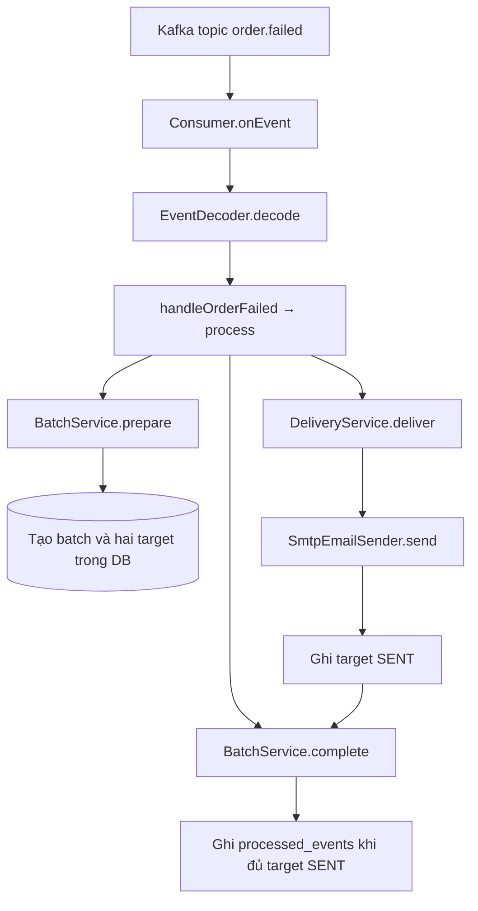

# Đọc code Notification và Analytics

Bắt đầu bằng luồng `order.failed` trong mục 1, sau đó đọc `order.paid` trong mục 4. Hai luồng này giúp theo dấu một message từ Kafka tới các dòng DB. Phần REST, xác thực và WebSocket được nối vào sau đó.

Code đã có Javadoc tiếng Việt ở lớp, hàm và trường dữ liệu. Trong IntelliJ, xem chú thích đầu lớp để biết trách nhiệm, đọc chú thích đầu hàm để biết đầu vào/kết quả, rồi theo các ghi chú ngay tại bước claim, transaction, gửi SMTP và publish dashboard.

## 1. Lần đọc đầu tiên với order.failed

Mở [JSON mẫu order.failed](kafka/samples/order.failed.json), ghi nhớ `messageId`, `orderId`, `customerId`, `customerEmail` và `reason`. Tiếp theo mở các file theo đúng thứ tự bảng.

| Thứ tự | File và hàm cần đọc | Câu hỏi cần trả lời |
|---|---|---|
| 1 | [NotificationEventConsumer](../notification-service/src/main/java/com/eventhub/notification/messaging/NotificationEventConsumer.java), `onEvent` | Topic nào gọi vào hàm này, nhánh switch nào chọn handler? |
| 2 | [EventDecoder](../notification-service/src/main/java/com/eventhub/notification/messaging/EventDecoder.java), `decode` | JSON có đúng record, đủ trường, đúng eventType và key không? |
| 3 | [OrderFailedEvent](../notification-service/src/main/java/com/eventhub/notification/messaging/event/OrderFailedEvent.java) | Các tham số handler nhận được mang ý nghĩa gì? |
| 4 | [NotificationProcessingServiceImpl](../notification-service/src/main/java/com/eventhub/notification/service/impl/NotificationProcessingServiceImpl.java), `handleOrderFailed` rồi `process` | Model cho template gồm những biến nào, handler gọi bước nào tiếp? |
| 5 | [NotificationBatchService](../notification-service/src/main/java/com/eventhub/notification/service/NotificationBatchService.java), `prepare` | Batch được kiểm tra và tạo đủ EMAIL/IN_APP như thế nào? |
| 6 | [NotificationDeliveryRepository](../notification-service/src/main/java/com/eventhub/notification/repository/NotificationDeliveryRepository.java), `lockBatch`, `targets`, `create` | Những dòng nào được lưu, unique key và khóa batch bảo vệ điều gì? |
| 7 | [NotificationDeliveryService](../notification-service/src/main/java/com/eventhub/notification/service/NotificationDeliveryService.java), `deliver` | Worker nhận quyền gửi, gia hạn lease và ghi kết quả ở đâu? |
| 8 | [SmtpEmailSender](../notification-service/src/main/java/com/eventhub/notification/service/impl/SmtpEmailSender.java), `send` | Lời gọi nào thực sự gửi email tới SMTP? |
| 9 | Quay lại `process` → `NotificationBatchService.complete` → repository `complete` | Khi nào message nguồn được ghi hoàn tất? |

Một lần đọc có thể đi qua nhiều file vì mỗi lớp đảm nhiệm một phần của luồng. `process` là chỗ nên quay lại khi muốn nhìn toàn bộ thứ tự gọi của Notification.



### Theo dõi DB của một message M

| Thời điểm | notification_batches | notifications | processed_events |
|---|---|---|---|
| Trước prepare | Chưa có M | Chưa có target M | Chưa có M |
| Prepare commit | M PENDING, expected_count=2 | Một IN_APP SENT và một EMAIL PENDING | Chưa có M |
| SMTP thành công, markSent commit | M PENDING | Cả hai target SENT | Chưa có M |
| Complete commit | M COMPLETE | Hai target SENT | Có M |

IN_APP có `status=SENT` nghĩa là nội dung đã sẵn sàng trong DB cho người nhận. `readAt=null` cho biết người dùng chưa đánh dấu đã đọc. API đánh dấu đọc thay đổi `readAt`.

## 2. Hiểu cách Java và Spring nối các file

| Khi gặp trong code | Cách đọc |
|---|---|
| `NotificationProcessingService` | Interface công bố các thao tác, đọc implementation để xem logic thực hiện |
| `NotificationProcessingServiceImpl` | Lớp thực hiện các phương thức của interface |
| Constructor nhận repository/service | Spring truyền các bean phụ thuộc vào khi tạo object |
| `private final ...` | Thành phần được object giữ để gọi ở các phương thức sau |
| `@Component`, `@Service`, `@Repository` | Các lớp được Spring đăng ký và quản lý theo trách nhiệm của chúng |
| `@Configuration`, `@Bean` | File cấu hình và phương thức tạo thành phần dùng chung |
| `@Override` | Phương thức hiện thực hoặc thay thế hợp đồng từ interface/lớp cha |
| `record OrderFailedEvent(...)` | DTO bất biến, Java tạo constructor và accessor như `event.orderId()` |
| `extends JpaRepository<Entity, UUID>` | Spring Data cung cấp sẵn các thao tác như findById/save và triển khai truy vấn repository |
| `@Entity`, `@Column`, `@JdbcTypeCode` | Khai báo bảng/cột và cách map kiểu Java, các UUID được lưu CHAR(36) |
| `status -> repository.claim(...)` | Lambda được TransactionTemplate gọi khi transaction đã mở, status ở đây là ngữ cảnh transaction |
| `Optional.empty()` | Kết quả đang không có dữ liệu phù hợp, caller cần đọc nhánh xử lý rỗng |
| `@Valid`, `@NotNull`, `@NotBlank` | Quy tắc kiểm tra dữ liệu, EventDecoder gọi validator cho các Kafka DTO |
| `@Getter`, `@Setter`, `@Builder` | Lombok tạo accessor/builder khi biên dịch, các entity dùng các annotation này |

Ví dụ trong `NotificationDeliveryService`, constructor nhận `NotificationDeliveryRepository`, `EmailSender`, `PlatformTransactionManager` và `Clock`. Sau khi Spring tạo object, `deliver` dùng các thành phần này để đọc/ghi DB, gọi SMTP, mở transaction và lấy thời gian.

`EmailSender` hiện được hiện thực bởi `SmtpEmailSender`. Khi đang đọc lời gọi `sender.send(...)`, mở implementation này để xem thao tác tạo MIME và gửi mail.

## 3. Đọc thêm hai luồng Notification còn lại

### ticket.issued

Đọc [TicketIssuedEvent](../notification-service/src/main/java/com/eventhub/notification/messaging/event/TicketIssuedEvent.java) rồi tới `handleTicketIssued`. Handler lấy email người mua, tạo model gồm sự kiện và danh sách vé. Mỗi vé có `qrCodeValue` và `cid`.

`TemplateRenderer` điền model vào HTML có thẻ ảnh tham chiếu `cid`. `SmtpEmailSender.png` tạo PNG từ token QR gốc, `helper.addInline` đính kèm PNG cùng Content-ID. Người mua nhận một email chứa các vé trong lô. [TemplateRenderer](../notification-service/src/main/java/com/eventhub/notification/service/TemplateRenderer.java), [SmtpEmailSender](../notification-service/src/main/java/com/eventhub/notification/service/impl/SmtpEmailSender.java).

### order.refunded

Đọc `handleOrderRefunded`, chú ý handler chọn `ORDER_REFUNDED` và đưa `amount` vào model. Phần prepare/deliver/complete dùng chung với hai handler còn lại.

### Tại sao cần fingerprint và lease?

| Thành phần | Tình huống nó xử lý |
|---|---|
| `messageId` | Kafka phát lại cùng sự kiện nguồn |
| `fingerprint` | Cùng messageId nhưng nội dung event đã thay đổi |
| `dedupKey` | Xác định duy nhất target của message theo channel và người nhận |
| `leaseToken` | Phân biệt lượt worker đang giữ quyền gửi với lượt đã mất quyền |
| `leaseUntil` | Cho phép lượt khác claim lại khi worker cũ ngừng gia hạn |
| `attempts` | Ghi số lần bắt đầu thử giao EMAIL |
| `expectedCount` | Chỉ hoàn tất batch sau khi đã tạo đủ target |

Trong `deliver`, đọc ba đoạn theo thứ tự claim → SMTP → markSent/markFailed. Các đoạn ghi DB có transaction ngắn, lời gọi SMTP nằm giữa các đoạn đó. Heartbeat gia hạn lease mỗi 20 giây trong lúc gửi.

Nếu SMTP đã nhận email mà tiến trình dừng trước khi ghi SENT, một lần retry sau có thể gửi lại email. Việc này được mô tả tại chỗ ghi kết quả và trong [hướng dẫn triển khai](notification-analytics-implementation.md).

## 4. Lần đọc Analytics đầu tiên với order.paid

Mở [JSON mẫu order.paid](kafka/samples/order.paid.json). Ví dụ có hai vé VIP, đơn giá 500000 và tổng dòng 1000000.

| Thứ tự | File và hàm | Cần chú ý |
|---|---|---|
| 1 | [AnalyticsEventConsumer](../analytics-service/src/main/java/com/eventhub/analytics/messaging/AnalyticsEventConsumer.java), `onEvent` | Chọn handler và bắt DuplicateMessageException sau khi service trả lỗi |
| 2 | [EventDecoder](../analytics-service/src/main/java/com/eventhub/analytics/messaging/EventDecoder.java), `decode` | Validate event tương tự Notification |
| 3 | [OrderPaidEvent](../analytics-service/src/main/java/com/eventhub/analytics/messaging/event/OrderPaidEvent.java) | Phân biệt messageId, eventId, orderId và các dòng items |
| 4 | [AnalyticsProjectionServiceImpl](../analytics-service/src/main/java/com/eventhub/analytics/service/impl/AnalyticsProjectionServiceImpl.java), `handlePaid` | Kiểm tra tổng dòng, claim, cập nhật metric/snapshot và phát tín hiệu dashboard |
| 5 | [ProjectionRepository](../analytics-service/src/main/java/com/eventhub/analytics/repository/ProjectionRepository.java), `claim`, `lockSnapshot`, `addSalesSnapshot` | INSERT unique messageId và khóa snapshot theo event |
| 6 | [SalesMetricRepository](../analytics-service/src/main/java/com/eventhub/analytics/repository/SalesMetricRepository.java), `upsertSale` | SQL cộng vào đúng dòng unique event/type/ngày |
| 7 | [DashboardPushService](../analytics-service/src/main/java/com/eventhub/analytics/service/DashboardPushService.java), `onChanged` | Callback chạy sau commit, gửi DTO dashboard cho các client |

Toàn bộ thao tác DB trong `handlePaid` nằm trong một transaction. Cùng message được nhận lại sẽ vướng unique của `processed_events.id`, làm rollback lần claim trùng. Consumer bắt `DuplicateMessageException` sau khi rời service proxy. Nếu một câu SQL về sau thất bại, claim và các thay đổi số liệu cùng rollback để lần retry xử lý được.

Với JSON mẫu, lần xử lý thành công đầu tiên cộng 1000000 và hai vé. Phát lại đúng messageId vẫn giữ kết quả đó.

### Gộp, hoàn và thuần nằm ở đâu?

| Trường | Ý nghĩa hiện tại |
|---|---|
| `sales_metrics.revenue`, `tickets_sold` | Doanh thu và số vé gộp từ order.paid |
| `sales_metrics.refunded_amount`, `tickets_refunded` | Khoản hoàn từ order.refunded |
| `SalesReportResponse.netRevenue` | Giá trị tính khi đọc báo cáo bằng gộp trừ hoàn |
| `dashboard_snapshot.total_revenue`, `total_tickets_sold` | Tổng gộp của cả sự kiện theo lựa chọn hiện tại |
| `metric_date` | Ngày Việt Nam suy ra từ paidAt hoặc refundedAt |

`handleRefunded` ghi phần hoàn theo `refundedAt`, đối chiếu tổng `items[].refundedAmount` với `amount`. Hai handler giữ dấu thời gian nghiệp vụ gốc để replay vẫn xếp vào đúng ngày báo cáo.

## 5. Đọc attendance bằng bảng trước/sau

Trong `handleScan`, mở lần lượt `lockTicket`, record `AttendanceEvidence`, `contribution` và `recordAttendance` của ProjectionRepository.

| Bằng chứng đang có | Vé đóng góp currentAttendance | Vé đóng góp totalCheckedIn |
|---|---:|---:|
| Chưa IN, chưa OUT | 0 | 0 |
| Có IN, chưa OUT | 1 | 1 |
| Có IN, có OUT | 0 | 1 |
| Chưa IN, đã OUT | 0 | 0 |

Handler tính chênh lệch giữa hàng trước và sau, rồi cộng chênh lệch vào snapshot. Ví dụ OUT đến trước tạo bằng chứng ra cổng với current=0. IN đến sau bổ sung bằng chứng vào, current vẫn 0 và totalCheckedIn tăng 1.

`AttendanceState` lưu bằng chứng lâu dài cho từng vé, `AttendanceLog` ghi dấu các message quét, còn `DashboardSnapshot` giữ số tổng hợp để API đọc nhanh. [AttendanceState](../analytics-service/src/main/java/com/eventhub/analytics/entity/AttendanceState.java), [AttendanceLog](../analytics-service/src/main/java/com/eventhub/analytics/entity/AttendanceLog.java), [DashboardSnapshot](../analytics-service/src/main/java/com/eventhub/analytics/entity/DashboardSnapshot.java).

## 6. Từ dữ liệu đã lưu tới REST API

Luồng đọc Notification đi từ `NotificationController` → `NotificationServiceImpl` → `NotificationRepository`. Actor cung cấp userId để lọc IN_APP, DTO trả title/content đã render. `Page.map` giữ thông tin phân trang khi chuyển entity sang response.

Luồng đọc Analytics có thêm bước kiểm tra event trước khi đọc DB.

```text
AnalyticsController
    → AnalyticsQueryServiceImpl
        → EventAccessServiceImpl
            → EventClientImpl
                → ServiceTokenProvider và internal Event API
        → AnalyticsReportReadService
            → SalesMetricRepository / DashboardSnapshotRepository
                → DTO trả HTTP
```

`AnalyticsQueryServiceImpl` điều phối kiểm tra quyền trước, `AnalyticsReportReadService` mở transaction đọc DB sau đó. `SalesMetricQueriesImpl` thực thi phần SQL tổng hợp và map kiểu dữ liệu JDBC vào record kết quả. [AnalyticsQueryServiceImpl](../analytics-service/src/main/java/com/eventhub/analytics/service/impl/AnalyticsQueryServiceImpl.java), [AnalyticsReportReadService](../analytics-service/src/main/java/com/eventhub/analytics/service/impl/AnalyticsReportReadService.java), [SalesMetricQueriesImpl](../analytics-service/src/main/java/com/eventhub/analytics/repository/SalesMetricQueriesImpl.java).

ADMIN được xem event tồn tại, ORGANIZER cần trùng owner, CUSTOMER bị từ chối. EventClient gọi API nội bộ bằng token service có cache và timeout. [EventAccessServiceImpl](../analytics-service/src/main/java/com/eventhub/analytics/service/impl/EventAccessServiceImpl.java), [EventClientImpl](../analytics-service/src/main/java/com/eventhub/analytics/client/EventClientImpl.java), [ServiceTokenProvider](../analytics-service/src/main/java/com/eventhub/analytics/client/ServiceTokenProvider.java).

## 7. Đọc security sau khi hiểu đường đi nghiệp vụ

Mở `SecurityConfig`, đọc `jwtDecoder` rồi `securityFilterChain`. Tiếp theo mở `ActorAuthenticationConverter.convert` và record `Actor`.

| Dữ liệu / thành phần | Vai trò |
|---|---|
| `issuer` | Kiểm tra nơi cấp token |
| `audience` | Kiểm tra token được cấp cho API nào |
| `jwk-set-uri` | Nguồn khóa công khai dùng xác minh chữ ký |
| `role-claim` | Đường dẫn lấy role từ JWT đã xác minh |
| `Actor` | userId và business role truyền vào controller/service |
| `@AuthenticationPrincipal` | Spring lấy principal từ Authentication gán vào tham số controller |
| Entry point / access denied handler | Trả ErrorResponse cho lỗi bị chặn ngay tại filter |
| `GlobalExceptionHandler` | Trả ErrorResponse cho lỗi trong quá trình bind/controller/service |

Converter yêu cầu subject UUID hợp lệ, claim exp và đúng một business role. Sau khi xác thực và kiểm tra role ở đầu vào HTTP, service tiếp tục kiểm tra owner của dữ liệu đang yêu cầu.

[SecurityConfig Notification](../notification-service/src/main/java/com/eventhub/notification/config/SecurityConfig.java), [SecurityConfig Analytics](../analytics-service/src/main/java/com/eventhub/analytics/config/SecurityConfig.java), [ActorAuthenticationConverter](../analytics-service/src/main/java/com/eventhub/analytics/config/ActorAuthenticationConverter.java), [GlobalExceptionHandler](../analytics-service/src/main/java/com/eventhub/analytics/exception/GlobalExceptionHandler.java).

## 8. Đọc WebSocket sau cùng

| Thứ tự | File / hàm | Vai trò |
|---|---|---|
| 1 | [WebSocketConfig](../analytics-service/src/main/java/com/eventhub/analytics/config/WebSocketConfig.java) | Endpoint, Origin, broker và interceptor hai chiều |
| 2 | [DashboardSessionRegistry](../analytics-service/src/main/java/com/eventhub/analytics/websocket/DashboardSessionRegistry.java), `decorate` | Ghi socket mới với hạn chờ CONNECT 15 giây |
| 3 | [DashboardAuthorizationInterceptor](../analytics-service/src/main/java/com/eventhub/analytics/websocket/DashboardAuthorizationInterceptor.java), `preSend` | Xác thực CONNECT và kiểm tra quyền SUBSCRIBE theo event |
| 4 | Registry `authenticate`, `requireAuthenticated`, `closeExpired` | Gắn principal, kiểm tra hạn và đóng session hết hạn |
| 5 | [DashboardChangedEvent](../analytics-service/src/main/java/com/eventhub/analytics/service/DashboardChangedEvent.java) | Tín hiệu Spring phát trong handler projection |
| 6 | [DashboardPushService](../analytics-service/src/main/java/com/eventhub/analytics/service/DashboardPushService.java), `onChanged` | Chờ AFTER_COMMIT rồi chuẩn bị push |
| 7 | [DashboardReadService](../analytics-service/src/main/java/com/eventhub/analytics/service/DashboardReadService.java), `getForPush` | Đọc snapshot trong transaction mới |
| 8 | `SimpMessagingTemplate.convertAndSend` | Gửi DTO tới destination STOMP của event |

Các callback `afterConnectionEstablished`, `afterConnectionClosed`, `preSend` và `onChanged` được framework gọi ở thời điểm tương ứng. Chú thích cạnh annotation cho biết điểm nào chạy khi socket mở, frame đến, transaction commit hoặc application đóng.

## 9. Các annotation về transaction cần hiểu

| Annotation / API | Điều xảy ra trong luồng hiện tại |
|---|---|
| `@Transactional` trên handler Analytics | Claim, metric/state/log/snapshot cùng commit hoặc rollback |
| `@Transactional` trên prepare/complete batch | Tạo đủ target hoặc xác nhận đủ target trong transaction riêng |
| `TransactionTemplate.execute` | Mở các transaction ngắn ngay tại claim/gia hạn/ghi kết quả gửi email |
| `@Transactional(readOnly=true)` | Ranh giới đọc số liệu DB |
| `REQUIRES_NEW` của getForPush | Tạo transaction đọc mới trong callback sau commit |
| `@TransactionalEventListener(AFTER_COMMIT)` | Chỉ push sau khi dữ liệu của handler đã commit |

Spring áp dụng annotation transaction khi lời gọi đi qua proxy của bean. Các bước prepare/complete, delivery và đọc snapshot push được tách thành bean để caller đi qua đúng ranh giới đó.

## 10. KafkaTemplate và luồng lỗi ở vị trí nào?

Sau khi đọc xong đường đi thành công, mở `KafkaConfig` của từng service. `DefaultErrorHandler` tiếp nhận lỗi từ listener, `DeadLetterPublishingRecoverer` dùng KafkaTemplate để gửi record sang DLQ. `InvalidEventException` và `DeliveryInProgressException` giúp chọn chính sách xử lý theo loại lỗi.

| Công việc | API / điểm vào |
|---|---|
| Nhận Kafka | `@KafkaListener` ở hai EventConsumer |
| Gửi Kafka phục vụ DLQ | `KafkaTemplate` truyền vào recoverer trong KafkaConfig |
| Gửi email | `JavaMailSender` trong SmtpEmailSender |
| Push trình duyệt | `SimpMessagingTemplate` trong DashboardPushService |
| Đọc IN_APP / báo cáo | Các REST controller đọc dữ liệu đã lưu |

Khi listener hoàn tất hoặc recoverer gửi DLQ thành công, container tiếp tục commit offset của group theo cấu hình hiện tại. `processed_events` là dấu nghiệp vụ trong DB của service, offset là tiến độ đọc Kafka của group.

Sơ đồ chín topic và các nhánh publisher/consumer ở [flows.md](kafka/flows.md). Các biến môi trường và hướng dẫn khởi động ở [hướng dẫn triển khai](notification-analytics-implementation.md). DDL, ý nghĩa cột và migration có trong [database Notification](database/notification-service/fields.md) và [database Analytics](database/analytics-service/fields.md).
